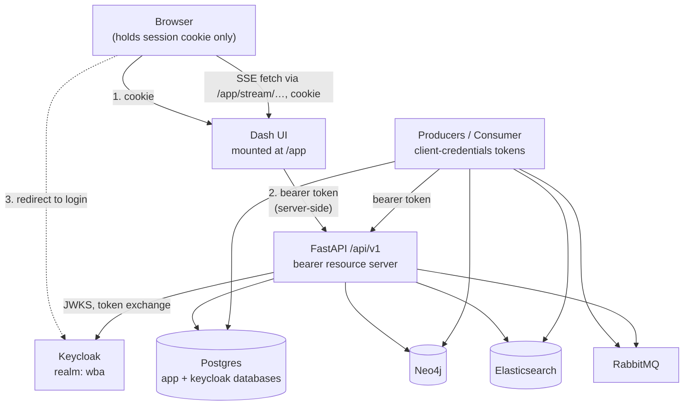
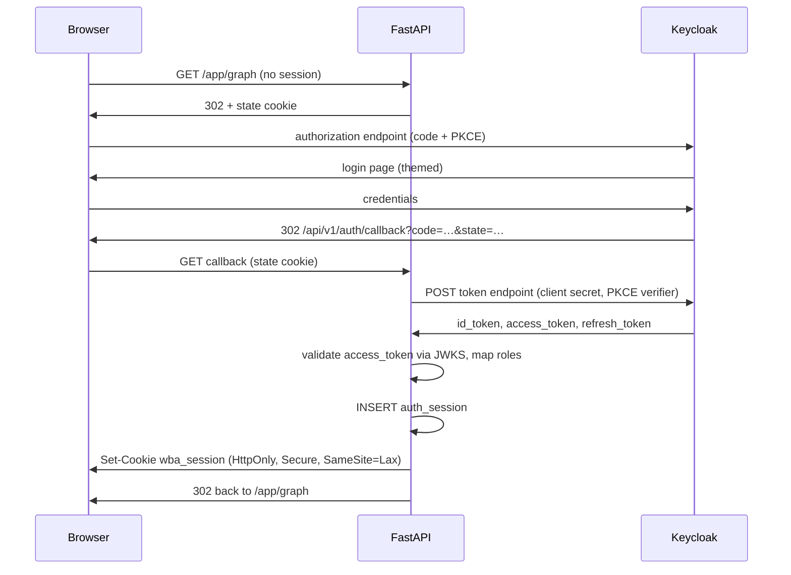

# Authentication and Authorization Design

**Audience:** Engineers implementing AuthN/AuthZ, reviewers of the security surface, and anyone
reasoning about the API as the product boundary.

**Status:** Implemented. This document describes the system as built.

---

## Overview

Identity is delegated to **Keycloak**, which this repository runs as part of its own Docker
Compose stack. Authorization distinguishes a **read-only** role from an **admin** role.

The **API is the product**. Every frontend — Dash, or a React SPA or thick client in future —
is an ordinary authenticated API client, and the presentation layer is physically separated
from the API and stripped of database access. A frontend shortcut into the in-process service
layer is a defect, not a path to guard.

Four properties drive most of the design decisions below:

1. **The UI and API are separate runtimes.** The presentation layer cannot reach a database at
   all; it holds no database driver, no data-store credentials, and no LLM provider key. This is
   what makes the API the single point of access to data.
2. **One credential type at the API.** `/api/v1` accepts `Authorization: Bearer <JWT>` and
   nothing else. This keeps the API frontend-agnostic and makes a future non-Dash frontend a
   client, not a port.
3. **The browser never holds a token.** Dash is a Backend-for-Frontend: the browser holds only
   an HttpOnly session cookie, and Dash's server-side callbacks attach the bearer token when
   they call the API. XSS cannot exfiltrate a credential.
4. **Enforcement is at the API, never in the UI.** Hiding a control is cosmetic; the API is the
   authority. A forged request from a standard user still receives `403`.

---

## Decision Summary

| # | Decision | Rationale |
|---|---|---|
| 1 | Keycloak-hosted login page, Authorization Code + PKCE | Standard SSO; MFA, password policy, lockout and federation come free. The "login screen" is Keycloak's, themed to match. |
| 2 | Keycloak runs in this repository's Compose stack, realm-as-code | Keeps the self-hosted model; reproducible dev and CI. `KEYCLOAK_ISSUER` remains a setting, so pointing at a different Keycloak instance is a config change. Enterprise SSO is absorbed by **brokering** inside realm `wba` and does not change the issuer. |
| 3 | Reuse the existing Postgres with a separate `keycloak` database | One fewer container. Accepted cost: Keycloak availability and backup blast radius become coupled to the application database server. |
| 4 | `/api/v1` accepts **bearer JWTs only** | One credential type, one enforcement point, one test story. The API stays frontend-agnostic. |
| 5 | Dash is a **BFF** with an HttpOnly session cookie | Browser never holds a token; revocation is immediate. The one browser-direct API call (the SSE stream) is routed through a Dash proxy route. |
| 6 | Realm roles `wba-admin`, `wba-user`, `wba-service` | One source of truth; identical validation for human and machine tokens; no user table. Unrecognised roles are denied, never downgraded. |
| 7 | Standard user reads everything except connector secrets; admin does everything; the service principal additionally reads secrets | A clean, useful capability line. The producers read their connector configuration, credentials included, over the API with a service token. |
| 8 | Scans are admin-or-service; chat is user-allowed | A scan causes producers to **write** into the graph, so it needs more than a standard user. Chat is read-only in effect. |
| 9 | Per-user ownership of chat sessions and catalog favourites | Chat sessions are owner-scoped, closing the "any `session_id` is usable by anyone" hole. Catalog favourites are owner-scoped too: `catalog_metadata` carries a non-null `subject` column and is unique per `(catalog_id, subject)`, so the favourite toggle writes the caller's own row. |
| 10 | A Flask `before_request` hook for `/app`, FastAPI dependencies for `/api/v1` | Dependencies compose with the existing `app.dependency_overrides` test idiom; the UI is a standalone WSGI app, so a request hook is the only thing that guards it. |
| 11 | No `AUTH_ENABLED` fail-open switch | Tests override the principal dependency and sign real JWTs instead. |
| 12 | Access token 15 min; SSO idle 1 h; SSO max 8 h | Bounded exposure with silent server-side refresh. |
| 13 | No page-level nav hiding | Enforcement is at the API. `401` redirects to login; `403` renders a clear message. |
| 14 | Internal services use Keycloak client-credentials tokens | Keeps exactly one credential type at the API. A bearer-only API breaks the producers and consumer otherwise. |

---

## Architecture

### Topology

The important arrow is (1)→(2): the browser's credential stops at Dash. Dash mints the bearer
token for its own loopback calls. The API never learns which frontend is calling it.

### Login sequence

`SameSite=Lax`. `SameSite` is evaluated on scheme plus registrable domain, ignoring port, so
`Strict` would also work in the topologies this design specifies. `Lax` is preferred because it
survives Keycloak moving to a different registrable domain or scheme — a break `Strict` would
not reveal in dev, since dev is same-site.

### The principal

Every credential resolves to one object, so authorization rules are written once. It carries the
Keycloak `sub` (stable, never reused), a display username, the mapped internal roles, and which
credential type produced it — the last so session and bearer callers stay distinguishable in logs
and tests without changing an authorization rule.

Unrecognised realm roles are **dropped**, and a token carrying no recognised role is rejected with
`403` — never silently downgraded to the standard user role.

---

## Keycloak

### Realm as code

The realm is checked into the repository as JSON and imported on first boot via
`--import-realm`, giving dev and CI a reproducible identity provider.

| Element | Value |
|---|---|
| Realm | `wba` |
| Roles | `wba-admin`, `wba-user`, `wba-service` |
| Web client | `wba-web` — confidential, standard flow, PKCE `S256`, redirect `https://<external-host>/api/v1/auth/callback` |
| Service client | `wba-internal` — service accounts enabled, client-credentials grant, carries `wba-service` |
| Access token lifespan | 15 minutes |
| SSO Session Idle | 1 hour |
| SSO Session Max | 8 hours |
| Dev users | one seeded `dev-admin` and one `dev-user`, so `docker compose up` yields a working login immediately |

The realm JSON seeds a single admin so there is no bootstrap paradox. Further role assignment
is done in the Keycloak admin console.

**Realm changes are delivered by re-seeding, not by editing.** `--import-realm` is create-only:
it imports a realm that does not exist and skips one that already does, so editing the template
has no effect on a running stack. The supported path is to drop and recreate the realm database so
the next boot imports the current template. It is destructive and appropriate only for a dev
stack. Console edits are a scratchpad — live immediately, invisible to the template, and lost on
the next re-seed. **No non-destructive delivery path is configured**, and one — the official
Terraform provider for Keycloak is the usual choice — must exist before this stack runs anywhere
the realm has to survive a change.

### Deployment

Keycloak reuses the existing Postgres server with its **own database**, created on first boot by
an init script. Schemas never mix.

### Issuer URL

`KEYCLOAK_ISSUER` is the public realm URL, e.g. `https://host/auth/realms/wba`. It is matched
against every token's `iss` claim as an **exact string**, so a difference in scheme, trailing
slash, or letter case rejects every token.

The app also fetches Keycloak's discovery document, which supplies the endpoint URLs — the JWKS
URI, the end-session endpoint, and the issuer itself — so one base URL is configured rather than
each endpoint separately.

Keycloak's public hostname must be pinned so `iss` does not vary with how the request arrived.

The app container must be able to *fetch* discovery and JWKS from that URL, not merely validate
against it — and inside a container `localhost` is the container itself, so **one URL cannot serve
both**. There are two settings:

| Setting | Value | Used for |
|---|---|---|
| `KEYCLOAK_ISSUER` | `https://localhost/auth/realms/wba` | exact `iss` matching only — the URL the **browser** uses |
| `KEYCLOAK_INTERNAL_URL` | `http://keycloak:8080/auth/realms/wba` | the API's own discovery, token and JWKS fetches over the Docker network |

Two checks guard the issuer, at two different times and against two different mistakes.

**At startup**, settings validation fails the process unless `KEYCLOAK_ISSUER` begins with
`APP_PUBLIC_BASE_URL`. This catches a configuration typo before the app serves a single request,
and it is purely local — it reads no network.

**Discovery is fetched lazily, on the first request that needs it** — never at boot, so an
unreachable Keycloak cannot block startup. The fetched document's `issuer` is compared against
`KEYCLOAK_ISSUER`; a disagreement is logged as one clear line and rejected there, rather than
surfacing as a validation failure on every request. The document is then cached for the process
lifetime.

**Only `/auth/realms/*` and `/auth/resources/*` are proxied.** `/auth/resources/*` is the theme and
console static assets — without it the login page and account console load their HTML but never
initialise. Everything else under `/auth` (including `/auth/admin`, the admin console and the admin
REST API) returns `404`; the operator reaches the console on the loopback port the `keycloak`
service publishes only when asked, and the admin console uses a **separate** loopback origin
(`KC_HOSTNAME_ADMIN`) from the public one (`KC_HOSTNAME`).

### Enterprise SSO integration

Enterprise SSO is absorbed by **brokering**: an IdP is added inside realm `wba`. The app still
receives its callback from Keycloak, so `KEYCLOAK_ISSUER` is unchanged and the application is
untouched; IdP mappers map enterprise groups onto `wba-admin` / `wba-user`, preserving the
role model. Onboarding is a Keycloak admin-console change. Pointing at a *different Keycloak
instance* does change `KEYCLOAK_ISSUER`, but nothing else in this design.

### Availability

Validation is a **local** operation: the session row lives in Postgres and JWTs are verified
against a cached JWKS. Consequently, **Keycloak being down does not evict existing sessions** —
it blocks new logins and token refreshes only. This is a deliberate benefit of the session-store
choice and is what makes a 15-minute access token affordable.

JWKS is cached with a bounded refresh interval and refreshed on an unknown `kid`, so a Keycloak
key rotation does not require an application restart.

---

## Authorization Model

### Roles

| Role | Meaning |
|---|---|
| `wba-user` | Standard user. Read everything except connector secrets; manage their own chat sessions and their own catalog favourites. May edit **own** data, not shared configuration. |
| `wba-admin` | Everything a standard user can do, plus shared configuration and secret exposure. |
| `wba-service` | Machine principal. Reads everything a standard user reads, plus connector secrets; the only role that may write command status. |

### Endpoint grants

Every API operation carries exactly one authorization grant, drawn from a closed set:

| Grant | Requirement |
|---|---|
| `public` | No credential at all. Deliberately open, and the only such routes are health and the login/callback legs. |
| `session` | The `wba_session` cookie authenticates the handler itself. No bearer accepted. Confined to the two routes the BFF needs to turn a cookie into a bearer, and to revoke one. |
| `user` | Any authenticated principal — user, admin, or service. |
| `admin` | `wba-admin` only. |
| `service` | `wba-service` only. |
| a set of grants | Any one of the listed grants. Used where admin and service both qualify. |

**Per-endpoint grants are declared in the code.** `src/app/auth/matrix.py` holds the
`(method, path) → grant` table, applied to the routers at include time.
`tests/test_authz_matrix.py` fails CI when that table and the live routers disagree — an operation
with no row, a row with no live operation, or a row whose declared grant does not match the
dependency attached to the route.

### Enforcement points

Enforcement is split by client type.

**The browser surface (`/app/*`) is guarded by a request hook.** The UI is a standalone WSGI
application, not a FastAPI mount, so FastAPI dependencies cannot apply to it. The hook resolves
the session cookie and redirects to the login flow when it is absent. This matters because Dash's
internal callback route executes every server-side callback — it is a real data path, not just
page rendering.

**`/api/v1` is guarded by FastAPI dependencies.** A small set of dependencies resolve the
principal and check the grant, applied per router.

**Exactly two endpoints accept the session cookie instead of a bearer:** the token exchange and
logout. The BFF needs both — one to turn a cookie into a bearer, the other to end the SSO session
at Keycloak. This is the only exception to "bearer only", and it is bounded to these two paths.

Response shape on failure is deliberately asymmetric: `/api/*` returns `401`/`403` **JSON**,
while `/app/*` HTML navigations receive a **302** to the login flow. Returning a redirect to an
XHR would hand Dash an HTML body where it expects JSON.

### Service accounts

The producers and the consumer call `/api/v1` over HTTP, and a bearer-only API breaks them. They
authenticate with the `wba-internal` client via the client-credentials grant, fetching a token at
startup and refreshing on expiry. This keeps a **single** credential type at the API: the only
difference between a human and a machine token is which role it carries.

Failure to obtain a service token is fatal to the call, not something the caller papers over. An
authentication failure is a configuration or availability fault, and continuing with environment
defaults would hide it while the process runs on settings nobody chose. It must surface loudly.

A runtime-settings read therefore propagates the failure rather than substituting defaults. Its
existing fallback to environment defaults exists for a different case — the API being genuinely
unreachable from a CLI utility run outside Compose — and must not double as a bypass for a failed
credential.

Command-status reporting is the exception, because the reporting is best-effort: a failed update
is logged and dropped. Losing one status record degrades the Recent Actions view but does not make
the scan's behaviour incorrect.

---

## Session Management

### Storage

A session is a server-side row, not a signed cookie: opaque id, Keycloak `sub`, username, a roles
snapshot, the encrypted refresh token, and created/expiry/last-seen/revoked timestamps. The
refresh token is encrypted at rest with the application's existing Fernet machinery, so it is
never stored in plaintext.

### Lifetimes

| Setting | Value | Effect |
|---|---|---|
| Access token | 15 min | Bearer lifetime; refreshed silently server-side |
| SSO Session Idle | 1 h | An abandoned browser self-expires |
| SSO Session Max | 8 h | One re-login per working day |
| Session cookie | Session-scoped | No `Max-Age`; ends with the browser session |

Roles are re-read from the refreshed token, so a revoked role takes effect within one
access-token lifetime. Because the session row is the authority, logout revokes it — clearing
the session cookie and the UI's cached bearer token — immediately, so no new token can be
minted. A bearer already issued, however, remains valid until it expires, **at most 15 minutes**
after revocation. That bound is deliberate: shortening it would require mapping the session id
into the access token and a database read on every request, and the short access-token lifetime
is what makes the window affordable.

### Logout

Logout clears the local session row and performs **RP-initiated logout** at Keycloak's
`end_session_endpoint`, so the SSO session ends too rather than silently re-authenticating the
user on the next request. Back-channel logout is a documented follow-up.

### CSRF and the authorization response

**PKCE** is the authorization-response control; `state` (validated against a short-lived,
single-use cookie) is defense in depth on top of it. **`SameSite=Lax`** is the cookie-scope
control, blocking cookie attachment on cross-site `POST`s. Dash's callback `POST`s are same-site
JSON requests, and no state-changing `GET` exists. Together these are sufficient without a
separate CSRF token scheme.

---

## Dash Integration (BFF)

### The shared API client

A single shared client module is the only path from the UI to the API. It reads the session cookie
from Dash's underlying Flask request, resolves the session, obtains or refreshes the bearer token,
and attaches `Authorization: Bearer` to the loopback call to `/api/v1`.

Every UI call site goes through this client — connectors, timeline, settings, search, chat and
catalog alike. No page calls the API directly.

### The one browser-direct API call

The chat stream is the single call the **browser** makes to the backend itself, because a
token-streaming response cannot be relayed through a Dash callback. The browser holds a session
cookie and not a token, so a direct call to the stream endpoint would return `401`. It is
therefore routed through a cookie-authenticated **proxy route** on the UI server, which resolves
the session, attaches the bearer token, and streams the response back.

The proxy exists solely to attach a token; the bearer-only rule stays intact rather than being
weakened. The alternative — exempting the stream endpoint from bearer authentication so the
cookie works directly — was rejected: it would make the session cookie a first-class API
credential for one endpoint, which is the dual-credential path Decision 4 exists to avoid.

### Error handling

The shared client distinguishes the two failure modes, and this distinction is the whole of the
UI's auth behaviour:

- **`401`** — the session is gone (expired, revoked, or logged out). Redirect to the login flow
  and return the user to the page they were on.
- **`403`** — authenticated but not permitted. Render a clear, non-alarming message in the
  page's existing feedback region: a dedicated alert region near the top of the section, not a
  toast or a modal. The user must understand that the action was refused because of their role,
  not that the application is broken.

### No nav hiding

The sidebar is unchanged and all pages remain reachable by all authenticated users. This is
consistent with the API being the enforcement point: hiding links is cosmetic, and a user who
forges a URL still receives `403`. It also avoids the trap of page-level gating — several pages
mix user-relevant and admin-only features, so a page-level rule would be wrong for every page
that has one.

---

## Configuration

Ten settings carry this design. All are read at startup; none is editable at runtime.

| Setting | Runtime | Purpose |
|---|---|---|
| `KEYCLOAK_ISSUER` | API | The public realm URL. Matched byte-for-byte against every token's `iss` claim. |
| `KEYCLOAK_INTERNAL_URL` | API + producers + consumer | The realm URL these runtimes fetch discovery, JWKS and tokens from. Must be the Compose service address, because `localhost` inside a container is the container. |
| `APP_PUBLIC_BASE_URL` | API | The deployment's public origin. Builds the OAuth `redirect_uri` and, through the realm template, the realm's `redirectUris` / `webOrigins`. Must agree with `KEYCLOAK_ISSUER`'s origin. |
| `KEYCLOAK_CLIENT_ID` | API + UI | The `wba-web` client identifier. Not a secret. |
| `KEYCLOAK_CLIENT_SECRET` | API only | The `wba-web` secret, used for the token exchange. |
| `KEYCLOAK_SERVICE_CLIENT_ID` | API + producers + consumer | The `wba-internal` client identifier. Not a secret. |
| `KEYCLOAK_SERVICE_CLIENT_SECRET` | API + producers + consumer | The `wba-internal` secret, used for the client-credentials grant. |
| `AUTH_COOKIE_SECURE` | API | The `Secure` flag on the session cookie. Must be true wherever TLS terminates. |
| `AUTH_SESSION_IDLE_MINUTES` | API | Idle bound, enforced by the application against `last_seen_at`. |
| `AUTH_SESSION_MAX_HOURS` | API | Absolute bound, enforced by the application against `expires_at`. |

Both secrets are confined to the runtimes that perform a token exchange. The UI runtime
instantiates a credential-free settings model and must never hold either — it receives a bearer
from the API instead.

`AUTH_COOKIE_SECURE` and the public origin both come from the deployment's TLS and
proxy-awareness configuration. The login flow is incorrect without them.

---

## Audit Logging

Authentication events are structured log records correlated with the HTTP access log by request
id: login success and failure with the resolved roles, logout (distinguishing user-initiated from
expiry), `403` denials with the required role, token and key-refresh failures, and connector
secret exposure — the most sensitive read in the system.

No new storage is introduced. If a durable, queryable audit trail is later required, that is a
separate concern with its own retention and access rules.

---

## Testing Strategy

CI runs the unit suite with no backing services, and no Keycloak. Four consequences shape the
design:

1. **Authorization is enforced by dependencies, so it can be overridden.** A single fixture
   replaces the principal for every API test that drives the app in-process.
2. **Auth logic is tested with real tokens, not mocks.** Tests sign genuine JWTs against a
   generated keypair, so signature, expiry, issuer and role mapping are all genuinely exercised
   with no identity provider present. This is what makes an `AUTH_ENABLED` fail-open switch
   unnecessary.
3. **The full redirect-and-callback flow needs a real Keycloak,** so it lives in a small
   integration suite run against the Compose stack rather than in CI.
4. **Every declared endpoint grant is asserted against the live routers** — a route with no
   declared grant fails, a declaration with no route fails, and a declared grant that disagrees
   with the dependency actually attached fails too. A route cannot be added without deciding its
   authorization.

---

## Deployment Topologies

### Docker Compose

nginx terminates TLS in front of the application and Keycloak. The application sees plain HTTP
internally, so nginx restates the client's scheme in `X-Forwarded-Proto`; the app derives its own
scheme from that header, and trusts it from **any** peer — safe only because the API publishes no
host port. Cookies carry `Secure`; `redirect_uri` is built from `APP_PUBLIC_BASE_URL`.

Two containers: the UI runtime (Dash only, no database access) and the API runtime (routers,
lifespan, scheduler). The UI container holds no provider credentials and no database drivers,
so a compromise of the presentation layer does not directly yield either.

### AWS API Gateway + ECS (target)

The same two runtimes (UI, API) run as separate ECS services behind API Gateway, with **TLS
terminating at the gateway** and nginx removed. Because the application never derives its own
external scheme or host, this is a configuration change rather than a code change — which is why
proxy-awareness is load-bearing, not an afterthought. The UI/API separation is what makes the two
services independently scalable and independently networkable: the UI service needs only the API,
and the API service is the only one that needs the data stores.

Two constraints to account for:

- **API Gateway integration timeouts are roughly 29–30 seconds** (REST and HTTP APIs). The chat
  stream `POST /api/v1/chats/{session_id}/stream` is a long-lived SSE response that the browser
  calls directly. A response exceeding that window will be cut by the gateway, not by application
  code. This may force WebSockets, a different ingress for streaming, or a shorter stream
  contract. **Verify against the specific API Gateway flavour before committing to a topology.**
- **Back-channel logout** requires Keycloak to reach the application. Behind API Gateway this is
  an additional reachability requirement, which is part of why it is deferred.

API Gateway's native JWT authorizer can validate Keycloak-issued tokens directly. That is an
option for the AWS topology, not a requirement, and is deliberately not designed here — the
application keeps validating tokens itself so the Docker and AWS topologies behave identically.

### Production checklist

Nothing in this design is localhost-only *by construction*, but several settings are dev
conveniences that must change for a real domain. Recorded so a deployment does not depend on
someone remembering.

**Configuration follows the public origin.** Set `APP_PUBLIC_BASE_URL` to the real origin and
`KEYCLOAK_ISSUER` to `<APP_PUBLIC_BASE_URL>/auth/realms/wba`; the realm's redirect URIs are
templated from the same value, so no realm edit is needed. `KEYCLOAK_INTERNAL_URL` becomes the
internal address of the identity provider.

**Remove everything that only exists for local access:** the Keycloak admin console and its
loopback port, the bootstrap admin credentials, and the local development certificates. A
production deployment has no published admin surface and an operator-managed admin or an external
identity provider — never a seeded one.

**Keep `AUTH_COOKIE_SECURE` true** wherever TLS terminates, and move the Keycloak database
password out of `.env` into a secret store.

No application code branches on host or scheme, so the Compose-to-ECS move is a configuration
change.
