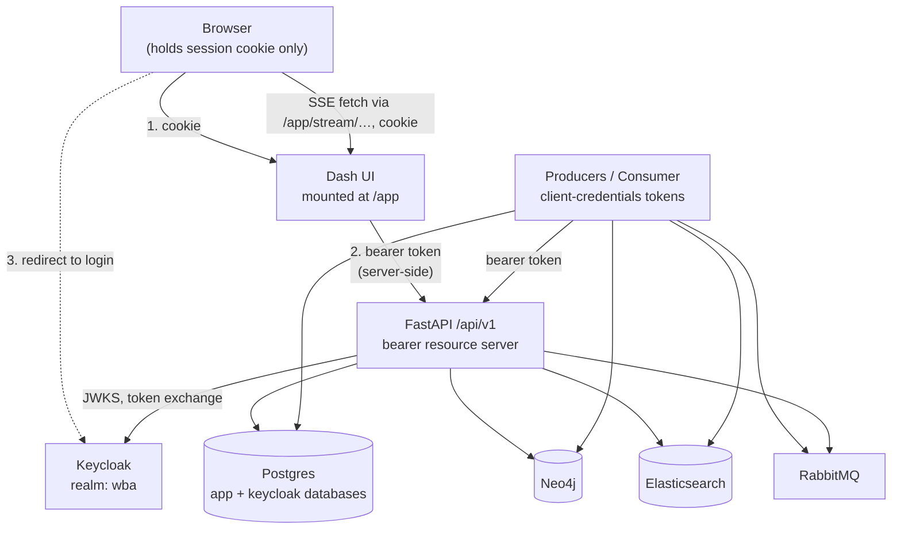
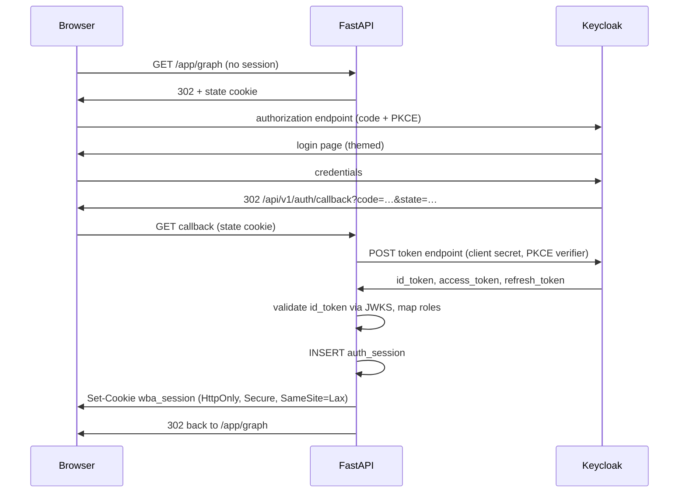

# Authentication and Authorization Design

**Audience:** Engineers implementing AuthN/AuthZ, reviewers of the security surface, and anyone
reasoning about the API as the product boundary.

**Status:** Design agreed; implementation plans not yet executed.

---

## Overview

This application currently has **no authentication and no authorization on any surface**. Every
HTTP endpoint, every Dash callback, and every backing service is reachable by anyone who can
reach the host. Two roles are required: a **read-only** role and an **admin** role. Identity is
delegated to **Keycloak**, which this repository runs as part of its own Docker Compose stack.

The change is not only "add a login". It moves the trust boundary. Today the Dash application
is a *peer* of the API — some pages call `/api/v1` over HTTP, three call the service layer
in-process, and both are equally "inside". After this change the **API is the product**, and
every frontend (Dash now, a React SPA or thick client later) is an ordinary authenticated API
client. The in-process shortcuts become defects to remove rather than paths to guard.

Reaching that point needs a prerequisite this document previously treated as implicit: the
presentation layer must be physically separated from the API and stripped of database access
(Plan B). Until then, "the API is the product" is a convention rather than a property — nothing
stops a Dash callback from reaching Neo4j directly, and three of them do today.

Four properties drive most of the design decisions below:

1. **The UI and API are separate runtimes.** The presentation layer cannot reach a database at
   all; it holds no database driver, no data-store credentials, and no LLM provider key. This is
   a prerequisite (Plan B), not a consequence of this design, and it is what makes the API the
   single point of access to data.
2. **One credential type at the API.** `/api/v1` accepts `Authorization: Bearer <JWT>` and
   nothing else. This keeps the API frontend-agnostic and makes a future non-Dash frontend a
   client, not a port.
3. **The browser never holds a token.** Dash is a Backend-for-Frontend: the browser holds only
   an HttpOnly session cookie, and Dash's server-side callbacks attach the bearer token when
   they call the API. XSS cannot exfiltrate a credential.
4. **Enforcement is at the API, never in the UI.** Hiding a control is cosmetic; the API is the
   authority. A forged request from a standard user still receives `403`.

---

## Non-Goals

Explicitly **out of scope** for this design, recorded so they are decisions rather than
omissions:

- **Multi-tenancy.** No tenant scoping of any kind.
- **Per-person or per-team data scoping.** Roles gate *capabilities*, never *rows*. Any
  authenticated user — standard or admin — can read the entire graph, including every tracked
  person's activity, timeline, and collaboration network. This is a deliberate choice, scoped as
  Plan F, and documented under [Future Considerations](#future-considerations).
- **TLS termination itself.** A separate prerequisite plan (Plan A) adds an nginx
  TLS-terminating proxy and makes the application proxy-aware. This design *assumes* HTTPS and
  specifies the cookie and redirect-URI behaviour that depends on it.
- **Splitting the UI and API into separate runtimes.** Plan B does this, together with the
  API-completeness audit. This design *assumes* it has landed: the BFF model and the shared HTTP
  client both build on that separation.
- **Hardening the host-exposed infrastructure ports.** Neo4j, Elasticsearch, RabbitMQ,
  Postgres, and `github-mcp` are inventoried in [Non-API Surfaces](#non-api-surfaces) and
  handled by a separate plan (Plan E).
- **Per-user configuration storage.** Per-user state — graph themes a user creates, and any
  future preferences — requires a data model that does not exist. Deferred to Plan D, sequenced
  *after* this one, because a preference cannot be keyed by a subject before a subject exists.
  Until Plan D lands, the theme-authoring row in the endpoint matrix is admin-only in practice.
- **Per-person data scoping.** Reads are not scoped to the caller. Named as Plan F so it stays
  visible, but neither designed nor costed here — see
  [Future Considerations](#future-considerations).
- **Outbound MCP OAuth.** `src/app/ai_agent/mcp_integration/` acting as an OAuth *client*
  against third-party MCP servers is a different problem from securing this application's own
  API, and is not covered.
- **Back-channel logout.** RP-initiated logout is in scope; Keycloak-initiated back-channel
  logout is documented as a follow-up.
- **API Gateway specifics.** The AWS topology is documented as a target, not designed here.

---

## Decision Summary

| # | Decision | Rationale |
|---|---|---|
| 1 | Keycloak-hosted login page, Authorization Code + PKCE | Standard SSO; MFA, password policy, lockout and federation come free. The "login screen" is Keycloak's, themed to match. |
| 2 | Keycloak runs in this repository's Compose stack, realm-as-code | Keeps the self-hosted model; reproducible dev and CI. `KEYCLOAK_ISSUER` remains a setting, so pointing at a different Keycloak instance is a config change. Enterprise SSO is absorbed by **brokering** inside realm `wba` and does not change the issuer. |
| 3 | Reuse the existing Postgres with a separate `keycloak` database | One fewer container. Accepted cost: Keycloak availability and backup blast radius become coupled to the application database server. |
| 4 | `/api/v1` accepts **bearer JWTs only** | One credential type, one enforcement point, one test story. The API stays frontend-agnostic. |
| 5 | Dash is a **BFF** with an HttpOnly session cookie | Browser never holds a token; revocation is immediate. The one browser-direct API call (the SSE stream) is re-pointed at a Dash proxy route. |
| 6 | Realm roles `wba-admin`, `wba-user`, `wba-service` | One source of truth; identical validation for human and machine tokens; no user table. Unrecognised roles are denied, never downgraded. |
| 7 | Standard user reads everything except connector secrets; admin does everything | A clean, useful capability line. |
| 8 | Scans are admin-only; chat is user-allowed | A scan causes producers to **write** into the graph. Chat is read-only in effect. |
| 9 | Per-user ownership of chat sessions and catalog favourites | Closes the "any `session_id` is usable by anyone" hole and lets standard users keep the favourite toggle. |
| 10 | ASGI middleware for `/app`, FastAPI dependencies for `/api/v1` | Dependencies compose with the existing `app.dependency_overrides` test idiom; middleware is the only way to guard a mounted WSGI app. |
| 11 | No `AUTH_ENABLED` fail-open switch | Tests override the principal dependency and sign real JWTs instead. |
| 12 | Access token 15 min; SSO idle 1 h; SSO max 8 h | Bounded exposure with silent server-side refresh. |
| 13 | No page-level nav hiding | Enforcement is at the API. `401` redirects to login; `403` renders a clear message. |
| 14 | Internal services use Keycloak client-credentials tokens | Keeps exactly one credential type at the API. Forced into phase 1 because a bearer-only API breaks the producers and consumer otherwise. |

---

## Current State

### There is no authentication anywhere

Greps for `oauth`, `jwt`, `keycloak`, `authlib`, `passlib`, `bcrypt`, `itsdangerous`, `HTTPBearer`,
`Security(`, `OAuth2`, or `AuthenticationMiddleware` across `src/` return **no matches**. No
`requirements*.txt` contains an auth library. The only application middleware is
`add_request_context` (`src/app/main.py:158-181`), which injects and logs an `X-Request-ID` and
performs no access control. The only `Depends(...)` in the API is `get_async_db`.

There is also **no application user concept**: no `User` model, no principal, no session
identity. The `Person` nodes in the graph are *tracked people from GitHub/Jira/Confluence* —
data entities, not principals — and the `IdentityMapping` relationships link provider
identities, not application users. Nothing maps "who is signed in" to a `Person.wba_id`.

### Existing TODOs this design resolves

The connectors API carries two standing TODOs asking for exactly this:

- `src/app/api/connectors/v1/service.py:409-411` and `:477-479` — *"The `include_secrets` flag is
  a temporary measure. This should be replaced with a proper role-based access control check
  based on the authenticated user's permissions. Exposing secrets via a query parameter is not
  secure."*
- `src/app/api/connectors/v1/router.py:107` — *"This should be based on user permissions, not an
  explicit query parameter."*

Connector secrets are currently gated by a **query parameter**, which is to say not gated at
all. Under this design `include_secrets=true` becomes admin-only and the TODOs are removed.

---

## Architecture

### Topology



The important arrow is (1)→(2): the browser's credential stops at Dash. Dash mints the bearer
token for its own loopback calls. The API never learns which frontend is calling it.

### Login sequence



`SameSite=Lax`. `SameSite` is evaluated on scheme plus registrable domain, ignoring port, so
`Strict` would also work in the topologies this design specifies. `Lax` is preferred because it
survives Keycloak moving to a different registrable domain or scheme — a break `Strict` would
not reveal in dev, since dev is same-site.

### The principal

Every credential resolves to one object, so authorization rules are written once:

```python
@dataclass(frozen=True)
class Principal:
    subject: str          # Keycloak `sub` — stable, never reused
    username: str         # preferred_username, for display and audit
    roles: frozenset[str] # mapped internal roles
    credential: str       # "session" | "bearer"
```

`credential` exists so the two credential types stay distinguishable in logs and tests without
changing any authorization rule. Unrecognised realm roles are **dropped**, and a token carrying
no recognised role is rejected with `403` — never silently downgraded to the standard user role.

---

## Keycloak

### Realm as code

The realm is checked into the repository as JSON and imported on first boot via
`--import-realm`, giving dev and CI a reproducible identity provider.

| Element | Value |
|---|---|
| Realm | `wba` |
| Roles | `wba-admin`, `wba-user`, `wba-service` |
| Web client | `wba-web` — confidential, standard flow, PKCE `S256`, redirect `https://<external-host>/api/v1/auth/callback` |
| Service client | `wba-internal` — service accounts enabled, client-credentials grant, carries `wba-service` |
| Access token lifespan | 15 minutes |
| SSO Session Idle | 1 hour |
| SSO Session Max | 8 hours |
| Dev users | one seeded `dev-admin` and one `dev-user`, so `docker compose up` yields a working login immediately |

The realm JSON seeds a single admin so there is no bootstrap paradox. Further role assignment
is done in the Keycloak admin console.

### Deployment

Keycloak reuses the existing Postgres server with its **own database**. The application's
Postgres service has no init scripts today, so this introduces one: a SQL file mounted into
`/docker-entrypoint-initdb.d/` creating the `keycloak` role and database. Schemas never mix.

Accepted cost, recorded deliberately: Keycloak's availability, resource usage, and backup
blast radius become coupled to the application's database server. A restore or reset of the
application database now has the identity provider inside its failure domain.

### Issuer URL

`KEYCLOAK_ISSUER` is the public realm URL, e.g. `https://host/auth/realms/wba`. It drives OIDC
discovery (append `/.well-known/openid-configuration` — hence one setting rather than five) and
`iss` validation, which is an **exact string match**, so any scheme, trailing-slash, or case
difference rejects every token.

Keycloak's public hostname must be pinned so `iss` does not vary with how the request arrived.

**Open item for Plan C:** the app container must be able to *fetch* discovery and JWKS from that
URL, not merely validate against it. Either one URL is reachable from both browser and container
(nginx by service name), or a second internal URL setting is needed. Pin the Keycloak image
version too, since the hostname env var differs between the Quarkus and legacy WildFly images.

### Enterprise SSO integration

Enterprise SSO is absorbed by **brokering**: an IdP is added inside realm `wba`. The app still
receives its callback from Keycloak, so `KEYCLOAK_ISSUER` is unchanged and the application is
untouched; IdP mappers map enterprise groups onto `wba-admin` / `wba-user`, preserving the
role model. Onboarding is a Keycloak admin-console change. Pointing at a *different Keycloak
instance* does change `KEYCLOAK_ISSUER`, but nothing else in this design.

### Availability

Validation is a **local** operation: the session row lives in Postgres and JWTs are verified
against a cached JWKS. Consequently, **Keycloak being down does not evict existing sessions** —
it blocks new logins and token refreshes only. This is a deliberate benefit of the session-store
choice and is what makes a 15-minute access token affordable.

JWKS is cached with a bounded refresh interval and refreshed on an unknown `kid`, so a Keycloak
key rotation does not require an application restart.

---

## Authorization Model

### Roles

| Role | Meaning |
|---|---|
| `wba-user` | Standard user. Read everything except connector secrets; manage their own chat sessions, favourites, and graph themes. May edit **own** data, not shared configuration. |
| `wba-admin` | Everything a standard user can do, plus shared configuration and secret exposure. |
| `wba-service` | Machine principal. Exactly four endpoints, no more. |

### Endpoint matrix

| Feature | Endpoint | user | admin | service |
|---|---|---|---|---|
| Health | `GET /api/health` | public | public | public |
| Auth flow | `/api/v1/auth/login\|callback\|logout` | public | public | public |
| Who am I | `GET /api/v1/auth/me` | ✓ | ✓ | ✓ |
| Search | `GET /api/v1/search`, `/search/persons` | ✓ | ✓ | ✓ |
| Timeline | `GET /api/v1/activity/timeline`, `/suggest` | ✓ | ✓ | ✓ |
| Graph query | `POST /api/v1/graph/execute`, `/expand` | ✓ | ✓ | ✓ |
| Collaboration | `GET /api/v1/graph/collaboration-network[/ego]` | ✓ | ✓ | ✓ |
| Catalog browse | `GET /api/v1/queries/catalog*` | ✓ | ✓ | ✓ |
| Favourite toggle | `PUT /api/v1/queries/catalog-metadata/{id}` | ✓ *(own rows)* | ✓ | ✗ |
| Catalog authoring | `PUT/DELETE /api/v1/queries/catalog/{ns}/{slug}` | ✗ | ✓ | ✗ |
| Theme read | `GET /api/v1/graph_themes/`, `/effective`, `/{id}` | ✓ | ✓ | ✓ |
| Theme authoring | `POST/PATCH/DELETE`, `/clone` | ✓ *(own themes)* | ✓ | ✗ |
| Theme default | `POST /api/v1/graph_themes/{id}/set-default` | ✗ | ✓ | ✗ |
| Chat (own sessions) | `POST/GET/DELETE /api/v1/chats*`, `/{id}/stream` | ✓ | ✓ | ✗ |
| Chat metrics | `GET /api/v1/chats/metrics/stream` | ✓ | ✓ | ✗ |
| Connector status | `GET /api/v1/connectors/`, `/{type}` | ✓ | ✓ | ✗ |
| Connector configs | `GET /{type}/configs` | ✓ | ✓ | ✗ |
| **Secrets exposure** | `GET /{type}/configs?include_secrets=true` | **✗** | ✓ | ✗ |
| Connector config write | `POST/PUT/PATCH/DELETE /{type}/configs*` | ✗ | ✓ | ✗ |
| Connector test | `POST /{type}/test` | ✗ | ✓ | ✗ |
| Runtime settings read | `GET /api/v1/settings/` | ✓ | ✓ | ✗ |
| Runtime settings write | `PATCH/POST /api/v1/settings*` | ✗ | ✓ | ✗ |
| Recent Actions read | `GET /api/v1/commands/`, `/{id}` | ✓ | ✓ | ✓ |
| Scan trigger | `POST /api/v1/commands/` | ✗ | ✓ | ✓ |
| Command status write | `PATCH /api/v1/commands/{id}/status` | ✗ | ✗ | ✓ |
| Runtime snapshot | `GET /api/v1/settings/runtime-snapshot` | ✗ | ✗ | ✓ |

**Theme authoring is user-writable, but needs a schema change to become so.** The
`graph_themes` table has no owner column and `is_default` is a single global flag per
`base_theme` (`db/models/graph_theme.py:46-48`), so "own themes" does not exist yet — the same
per-user gap as Plan D. Until that migration lands, theme writes stay admin-only; the migration
adds nullable `subject` ownership, scopes user themes to their creator, and leaves the global
`is_default` (and all `builtin` rows) shared. **`/set-default` stays admin-only** because it
changes the global fallback every user sees.

Two rows are worth calling out. `POST /graph/execute` is safe for standard users because it is already
constrained to read-only Cypher by `src/app/api/graph/v1/cypher_read_only.py` plus
`validate_read_only_query` (`api/graph/v1/query.py:32`), which rejects `CREATE`/`MERGE`/`DELETE`/`SET`
and APOC write procedures. And **scan triggering is admin-only** because a scan publishes
commands that cause producers to fetch from GitHub/Jira/Confluence and **write** into the graph —
it mutates data even though the endpoint returns quickly.

### Enforcement points

Enforcement is split by client type, which is also the split that makes the existing test suite
survive:

**Flask `before_request` guards the browser surface (`/app/*`).** The UI is a standalone Flask
app (`src/ui_main.py` → `server = app.server`), served by gunicorn, so there is no FastAPI mount
for FastAPI dependencies to apply to. A Flask `before_request` hook on that server resolves the
session cookie and, when it is absent, redirects to the login flow. The SSE proxy uses
`stream_with_context` so the request context survives while the API response streams back.

This also covers Dash's own internal routes, which are a real data path: `POST
/app/_dash-update-component` executes every server-side callback, including the three that reach
Neo4j and Elasticsearch. Note the prefix configuration, which determines where the stream proxy
route below can be registered: in `src/ui/layout.py:27-28` **both** `requests_pathname_prefix`
and `routes_pathname_prefix` are set to `"/app/"`, so Dash registers its handlers under `/app`.
Consequently a Flask route registered as `/stream/<session_id>` on `server` is reachable by the
browser at `/app/stream/<session_id>` directly, with no mount involved, and the `before_request`
hook guards it.

**FastAPI dependencies guard `/api/v1`.** `get_principal`, `require_user`, `require_admin`, and
`require_service` read the principal resolved from the bearer token. This is the only shape that
composes with the idiom the test suite already uses — `app.dependency_overrides[get_async_db]`
(`tests/test_activity_api_integration.py:280`) — so the ~18 existing API test files keep working
with one autouse fixture.

Response shape on failure is deliberately asymmetric: `/api/*` returns `401`/`403` **JSON**,
while `/app/*` HTML navigations receive a **302** to the login flow. Returning a redirect to an
XHR would hand Dash an HTML body where it expects JSON.

### Service accounts

The producers and the consumer call `/api/v1` over HTTP today, and a bearer-only API breaks them:

| Caller | Call |
|---|---|
| `connectors/producers/daemon_common.py:291` | `GET /api/v1/commands/` |
| `daemon_common.py:323` | `PATCH /api/v1/commands/{id}/status` |
| `daemon_common.py:341` | `GET /api/v1/commands/{id}` |
| `common/runtime_settings/client.py:47` | `GET /api/v1/settings/runtime-snapshot` — called by all three producers (`daemon_common.py:525,636,683`) and the consumer (`consumers/main.py:206,217`) |

They authenticate with the `wba-internal` client via the client-credentials grant, fetching a
token at startup and refreshing on expiry. This keeps a **single** credential type at the API:
the only difference between a human and a machine token is which role it carries.

`src/app/scheduler.py` needs no change — it calls `create_and_publish_command()` **in-process**
(`scheduler.py:177`) and never crosses HTTP.

Note that `fetch_runtime_snapshot` already falls back to env/defaults on any failure
(`common/runtime_settings/client.py:55-63`), so a transient token failure degrades to defaults
rather than breaking a scan. Command-status reporting does **not** degrade — it is what feeds
the Recent Actions UI, which is why this path must be built in phase 1 rather than deferred.

---

## Session Management

### Storage

A new `auth_session` table (Alembic-migrated) holds: opaque session id, Keycloak `sub`,
username, a roles snapshot, the encrypted refresh token, `created_at`, `expires_at`,
`last_seen_at`, and `revoked_at`. The refresh token is encrypted at rest with the existing
Fernet machinery (`src/app/common/encryption.py`, keyed by `CONNECTOR_ENCRYPTION_KEY`) — or a
dedicated key; the plan will decide, but it must not be stored in plaintext.

### Lifetimes

| Setting | Value | Effect |
|---|---|---|
| Access token | 15 min | Bearer lifetime; refreshed silently server-side |
| SSO Session Idle | 1 h | An abandoned browser self-expires |
| SSO Session Max | 8 h | One re-login per working day |
| Session cookie | Session-scoped | No `Max-Age`; ends with the browser session |

Roles are re-read from the refreshed token, so a revoked role takes effect within one
access-token lifetime. Because the session row is the authority, a revoked or deleted row ends
access immediately regardless of token state.

### Logout

Logout clears the local session row and performs **RP-initiated logout** at Keycloak's
`end_session_endpoint`, so the SSO session ends too rather than silently re-authenticating the
user on the next request. Back-channel logout is a documented follow-up.

### CSRF and the authorization response

**PKCE** is the authorization-response control; `state` (validated against a short-lived,
single-use cookie) is defense in depth on top of it. **`SameSite=Lax`** is the cookie-scope
control, blocking cookie attachment on cross-site `POST`s. Dash's callback `POST`s are same-site
JSON requests, and no state-changing `GET` exists. Together these are sufficient without a
separate CSRF token scheme.

---

## Dash Integration (BFF)

### The shared API client

A single module (`dash_app/api_client.py`) replaces direct `requests` calls. It reads the
session cookie from Dash's underlying Flask request, resolves the session, obtains or refreshes
the bearer token, and attaches `Authorization: Bearer` to the loopback call to `/api/v1`.

Today ~16 files call the API directly with **no credentials at all** — including
`pages/connectors/callbacks.py`, `pages/timeline/api.py`, `pages/settings/runtime.py`,
`pages/search.py`, `pages/chat.py`, and `pages/catalog/*`. Every one of those call sites moves
to the shared client.

### The one browser-direct API call

`src/ui/assets/stream-bridge.js:215` is the single place where the **browser** calls
`/api/v1` directly:

```js
fetch('/api/v1/chats/' + sessionId + '/stream', {
    method: 'POST',
    headers: { 'Content-Type': 'application/json' },
    body: JSON.stringify({ message: message })
})
```

Under a bearer-only API this call returns `401`, because the browser holds a session cookie and
not a token. **This call site must change** — it is the one exception to "the browser never
talks to the API". The fix keeps the bearer-only rule intact rather than weakening it: add a
cookie-authenticated **Dash proxy route** — a plain Flask route on the UI's `server`
(`src/ui_main.py` → `server = app.server`), registered at `/stream/<session_id>` and therefore
browser-reachable at `/app/stream/<session_id>` — which resolves the session, attaches the bearer
token, and streams the API response back through to the browser.

The client change is then a one-line URL change to `/app/stream/<session_id>`. The proxy route
sits under `/app`, so it is already covered by the `before_request` guard described above. It
exists solely to attach a token; before auth lands the direct call still works.

The alternative — exempting `/chats/{id}/stream` from bearer authentication so the cookie works
directly — was rejected: it would make the session cookie a first-class API credential for one
endpoint, which is exactly the dual-credential path Decision 4 exists to avoid.

### Error handling

The shared client distinguishes the two failure modes, and this distinction is the whole of the
UI's auth behaviour:

- **`401`** — the session is gone (expired, revoked, or logged out). Redirect to the login flow
  and return the user to the page they were on.
- **`403`** — authenticated but not permitted. Render a clear, non-alarming message in the
  page's existing feedback region, following the `create_alert` convention
  (`dash_app/components/common.py:159`) with a dedicated region near the top of the section
  (`pages/settings/runtime.py:300` is the canonical example). The user must understand that the
  action was refused because of their role, not that the application is broken.

### No nav hiding

The sidebar is unchanged and all pages remain reachable by all authenticated users. This is
consistent with the API being the enforcement point: hiding links is cosmetic, and a user who
forges a URL still receives `403`. It also avoids the trap of page-level gating — several pages
mix user-relevant and admin-only features, so a page-level rule would be wrong for every page
that has one.

---

## Non-API Surfaces

The brief requires that paths reaching the backend without passing through the secured API be
identified and handled by a separate plan. The full inventory:

### 1. Application-internal bypasses

Three Dash callbacks used to reach Neo4j and Elasticsearch **in-process**, by importing the API's
own service functions. A request to the unauthenticated `POST /app/_dash-update-component` reached
them without touching `/api/v1`, so securing the API alone would have left these open. All three
are now resolved: each imports `ui.api_client` and calls the HTTP endpoint instead.

| Callback | Import | Reaches | Endpoint now used |
|---|---|---|---|
| `pages/collaboration_network/callbacks/filter.py:91` | `ui.api_client` (`:12-13`) | Neo4j | `GET /api/v1/graph/collaboration-network` |
| `pages/collaboration_network_ego/callbacks/filter.py:211` | `ui.api_client` (`:13-14`) | Neo4j | `GET /api/v1/graph/collaboration-network/ego` |
| `pages/graph/callbacks/spotlight.py:126` | `ui.api_client` (`:18`) | Elasticsearch | `POST /api/v1/search/scoped` |

All three were pure shortcuts — the HTTP endpoints already existed. The isolation is enforced by
the container split: the UI image carries neither a database driver nor a data-store client, so
an equivalent in-process shortcut cannot reappear.

Also worth noting: `pages/connectors/callbacks.py:13` and `pages/connectors/layout.py:7` import
`CONNECTOR_REGISTRY` from `src/domain/connector_registry.py`. That is a hardcoded dict, not a data
path, so it is a coupling to note rather than a bypass to close.

### 2. Host-exposed infrastructure → Plan E

These cannot be "put behind the API" because they are the API's own backing stores. They need
network and credential hardening, which is a different discipline:

| Service | Host ports | Current state |
|---|---|---|
| Elasticsearch | `9200`, `9300` | **`xpack.security.enabled=false`** — full read/write, no auth |
| Neo4j | `7474` (browser), `7687` (bolt) | Basic auth only; Community edition, so no RBAC |
| RabbitMQ | `5672`, `15672` (management UI) | Credentials default to `guest`/`guest` |
| Postgres | `5432` | User/password, no TLS |
| `github-mcp` | `8082` | Third-party image `ghcr.io/github/github-mcp-server`, **no auth**, holds a GitHub PAT |

### 3. Other exposures → Plan E

- **`scripts/temp_stream_server.py`** — a standalone FastAPI app binding `0.0.0.0:8001` with no
  auth, reaching `stream_chat` and streaming metrics. Its own docstring says "DO NOT use this
  server in production", but nothing enforces that.

### 4. Client-side callbacks

30 `clientside_callback` registrations exist across the Dash app. All but one manipulate the DOM,
Cytoscape, or theme classes and fetch no data. The single exception is
`src/ui/assets/stream-bridge.js:215`, which calls `/api/v1/chats/{id}/stream` directly from the browser
and must be re-pointed at the Dash proxy route described in
[Dash Integration](#dash-integration-bff).

### 5. Deliberately public — the API documentation routes

`GET /docs`, `/redoc` and `/openapi.json` are **intentionally served without authentication**.
nginx proxies all three to the API upstream (`deploy/nginx/nginx.conf`, the "API documentation"
location block), and the API serves them from FastAPI's defaults — `FastAPI(lifespan=lifespan)`
in `src/app/api_main.py` sets no `docs_url` / `redoc_url` / `openapi_url` override.

This is a **decision, not an oversight**, and it supersedes an earlier note in this document that
listed these endpoints as exposures for Plan E to close. The routes were unreachable for a period
by accident rather than by design: nginx routes only `/api` and `/app`, and the API publishes no
host port, so the API's own root paths had no browser-facing URL. Exposing them restores a
developer affordance lost in that transition.

Consequences to keep in view:

- **The full API schema is public** to anyone who can reach `localhost:443`. That is acceptable
  for a developer-local deployment; it is a deliberate exception to "the API is authorized",
  not an exemption from it. **Plan C must revisit it**: once Keycloak is in place, these routes
  either move behind the BFF session or are disabled via `docs_url=None`, at which point this
  section should become a record of a closed exposure.
- **`/docs` and `/redoc` load their JS/CSS from a CDN** (`cdn.jsdelivr.net`, `cdn.redoc.ly`).
  With no browser egress they render a blank page; the schema at `/openapi.json` is unaffected.
- **`/docs` is proxied as a prefix**, not an exact match, so Swagger's `/docs/oauth2-redirect`
  callback resolves. With `location = /docs` that sub-path returns nginx's own 404.
- **No `root_path` is set**, so the schema emits no `servers` entry and Swagger resolves its
  "Try it out" requests against the page origin — they arrive at `https://localhost/api/v1/...`
  and are proxied normally. Setting `root_path` would break that.
- The routes stay **inside the TLS server block** and do not introduce a catch-all: unmatched
  paths still 404 rather than being proxied to an upstream. `tests/test_nginx_docs_routes.py`
  (config structure) and `tests/test_docs_endpoints_server.py` (live over TLS) guard both.

---

## Configuration

New settings, declared per the nine-step procedure in `docs/design/runtime-settings-design.md`
where they are user-tunable, and as startup-only `Settings` fields where they are not:

| Setting | Kind | Purpose |
|---|---|---|
| `KEYCLOAK_ISSUER` | startup-only | Public issuer URL; must match the `iss` claim exactly |
| `KEYCLOAK_REALM` | startup-only | Realm name (`wba`) |
| `KEYCLOAK_CLIENT_ID` | startup-only | `wba-web` |
| `KEYCLOAK_CLIENT_SECRET` | startup-only, sensitive | Confidential client secret |
| `KEYCLOAK_SERVICE_CLIENT_ID` / `_SECRET` | startup-only, sensitive | `wba-internal` credentials for producers/consumer |
| `AUTH_COOKIE_SECURE` | startup-only | `Secure` flag; **must** be true wherever TLS terminates |
| `AUTH_SESSION_IDLE_MINUTES` | runtime-tunable | Idle timeout enforced by the application |
| `AUTH_SESSION_MAX_HOURS` | runtime-tunable | Absolute session cap |
| `EXTERNAL_BASE_URL` | startup-only | External scheme + host, used to build `redirect_uri` and cookie flags |

`EXTERNAL_BASE_URL` and `AUTH_COOKIE_SECURE` are owned by Plan A (TLS and proxy-awareness) and
consumed here. They are listed because the login flow is incorrect without them.

---

## Audit Logging

Authentication events are logged as structured records through the existing
`common.logger` with the request id already injected by `add_request_context`, so they correlate
with the HTTP access log:

- login success and failure, with `sub` and the resolved roles
- logout, distinguishing user-initiated from session expiry
- `403` denials, with the required role and the endpoint
- session refresh failures and JWKS refresh failures
- connector secret exposure (`include_secrets=true`), which is the single most sensitive read

No new storage is introduced; these are logs, not a database table. If a durable, queryable
audit trail is later required, that is a separate concern with its own retention and access
rules.

---

## Testing Strategy

CI runs `pytest -q -m unit tests --cov=src` with a dummy `DATABASE_URL` and **starts no
services** — there is no Keycloak in CI. The strategy follows from that:

1. **Existing tests keep working via one autouse fixture.** Because `/api/v1` enforcement lives
   in FastAPI dependencies, a single fixture installing `app.dependency_overrides[get_principal]`
   covers the ~18 API test files that hit the real `app` through `httpx.ASGITransport`.
2. **Auth logic is tested with real tokens, not mocks.** Auth-specific tests generate an RSA
   keypair, sign genuine JWTs, and point JWKS resolution at the test key. Signature verification,
   `exp`, `iss`, `aud`, and role mapping are all genuinely exercised with no Keycloak present.
   This is what makes the absence of an `AUTH_ENABLED` switch tolerable.
3. **A small `integration`-marked suite** runs against the Compose Keycloak for the full
   redirect-and-callback flow, excluded from CI exactly as the existing integration suites are
   (`pytest.ini` markers; CI runs `-m unit` only).
4. **Authorization is tested as a matrix.** A parametrized test asserts the endpoint matrix above
   for each role, so a route added later without a role dependency fails loudly rather than
   defaulting open. This is the single highest-value test in the change.

All new code must satisfy the existing gates: `mypy src/` strict, `pylint src` ≥ 9.0, and
`bandit -c .bandit.yml -r src/ -lll`.

---

## Deployment Topologies

### Docker Compose (current)

nginx terminates TLS in front of the application and Keycloak (Plan A). The application sees
plain HTTP internally and must trust `X-Forwarded-Proto` / `X-Forwarded-Host` from that proxy.
Cookies carry `Secure`; `redirect_uri` is built from `EXTERNAL_BASE_URL`.

Two containers: the UI runtime (Dash only, no database access) and the API runtime (routers,
lifespan, scheduler). The UI container holds no provider credentials and no database drivers,
so a compromise of the presentation layer does not directly yield either.

### AWS API Gateway + ECS (target)

The same two runtimes (UI, API) run as separate ECS services behind API Gateway, with **TLS
terminating at the gateway** and nginx removed. Because the application never derives its own
external scheme or host, this is a configuration change rather than a code change — which is the
entire reason the proxy-awareness work is a prerequisite rather than an afterthought. The Plan B
separation is what makes the two services independently scalable and independently networkable:
the UI service needs only the API, and the API service is the only one that needs the data
stores.

Two constraints to plan for:

- **API Gateway integration timeouts are roughly 29–30 seconds** (REST and HTTP APIs). The chat
  stream `POST /api/v1/chats/{session_id}/stream` is a long-lived SSE `StreamingResponse`
  (`api/chats/v1/router.py:39-72`) that the browser calls directly. A response exceeding that
  window will be cut by the gateway, not by application code. This may force WebSockets, a
  different ingress for streaming, or a shorter stream contract. **Verify against the specific
  API Gateway flavour before committing to a topology.**
- **Back-channel logout** requires Keycloak to reach the application. Behind API Gateway this is
  an additional reachability requirement, which is part of why it is deferred.

API Gateway's native JWT authorizer can validate Keycloak-issued tokens directly. That is an
option for the AWS topology, not a requirement, and is deliberately not designed here — the
application keeps validating tokens itself so the Docker and AWS topologies behave identically.

---

## Implementation Plans

Six plans. Dependency order is **A → B → C → D → E**, with **F** independent of all of them.

| Plan | Scope | Depends on |
|---|---|---|
| **A — TLS termination and proxy-awareness** | nginx in Compose, `EXTERNAL_BASE_URL`, trusted forwarded-header handling, `AUTH_COOKIE_SECURE`. Verified independently over HTTPS. | — |
| **B — Dash–API runtime separation and API completeness** | Split the UI and API into separate runtimes; the UI container loses all database access; every remaining in-process and direct-config shortcut is routed through `/api/v1`. Includes the API-completeness audit. Full scope below. | A |
| **C — Keycloak AuthN/AuthZ** | This design: Keycloak service and realm, `auth_session` table, bearer resource server, BFF session, roles, service accounts, the `/app/stream/<id>` SSE proxy route, per-user ownership of chat and favourites, UI error handling. | A, B |
| **D — Per-user configuration** | Adds nullable `subject` ownership to `graph_themes` (scoping user themes to their creator, keeping the global `is_default` shared) and a `user_preferences` table keyed by subject. Unlocks user-writable theme authoring. | C |
| **E — Infrastructure surface hardening** | Elasticsearch security, RabbitMQ credentials, Neo4j/Postgres port exposure, `github-mcp` exposure, `temp_stream_server.py`. The unauthenticated `/docs` / `/redoc` / `/openapi.json` routes are **not** in this scope — they are deliberately public (see [Non-API Surfaces §5](#5-deliberately-public--the-api-documentation-routes)), and Plan C owns their disposition. | — |
| **F — Per-person data scoping** | Scope reads to the caller's own person/team. Requires a subject→`Person.wba_id` link and a team model, neither of which exists. | C |

**Why B precedes C.** Locking the API down while any component still reaches the database
directly would either break that component or leave an unauthenticated path to Neo4j — defeating
the purpose. B is also independently verifiable, which de-risks C.

**Documentation changes required in C:** add this document to the reference table in `CLAUDE.md`
(which `.github/copilot-instructions.md` symlinks to), so an agent working on authentication
finds this design.

**Why F is broken out rather than left as a paragraph.** Per-person scoping was previously listed
only under Future Considerations. It is a real, costed piece of work with a hard dependency on C
and a data model that does not exist; leaving it as prose invited it to be forgotten. It is now
a named plan so the work is visible even while undesigned.

---

## Plan B Scope — Dash–API Runtime Separation

**This is a scope sketch for review, not an implementation plan.** A detailed plan requires
another pass.

### Why this exists

The application evolved with Dash and FastAPI in one process, which made it acceptable for the
Dash layer to reach the database by design. That is now the single thing blocking the stated
goal: that the Python Dash frontend can be replaced by another presentation layer in future.

Two properties are needed, and they are **not** the same property:

1. **Isolation** — the UI runtime cannot reach the database at all. This is enforcement, and the
   container split provides it.
2. **Adequacy** — the API exposes every capability the UI needs, so a different frontend could
   be built against it today. This is what the API-completeness audit provides.

The container split alone does not deliver (2). A UI container that talks only to `/api/v1` can
still be relying on endpoints shaped around Dash's needs. Both deliverables are therefore in
scope for this plan.

### What is already true (verified)

The separation is closer than the code's structure suggests:

- **The Dash layer has no direct database access.** Greps across `dash_app/` for `sqlalchemy`,
  `AsyncSession`, `ASYNC_SESSION_LOCAL`, `GraphDatabase`, `get_driver`, `Elasticsearch(`, and
  `pika.` return **no matches**. The isolation is already real at the code level; it is simply
  not *enforced*, because the container can still reach Postgres and Neo4j.
- **`src/common/` is the established cross-runtime shared location.** Both
  `Dockerfile.github-producer:18` and `Dockerfile.signal-consumer:18` do
  `COPY src/common/ /app/common`. Shipping one shared package into multiple runtimes is a solved
  pattern in this repository.
- **Most cross-layer coupling is DB-free domain logic.** The collaboration scoring algorithm,
  the config model and layer labels, the graph-theme math, node sizing, and the timezone helpers
  are all pure. They are only *architecturally* coupled, because they live under `app.*` rather
  than `common.*`.
- **The runtime-settings problem already has a mechanism.** `src/common/runtime_settings/`
  already provides `RuntimeConfigCache` and `fetch_runtime_snapshot(api_base)`
  (`client.py:47`) with an env/default fallback (`client.py:55-63`), and the producers and
  consumer already use it. No new machinery is required.

### Coupling inventory

82 files and roughly 26,000 LOC under `dash_app/`. **30 files (~19,000 LOC) import something
outside `app.dash_app`**, in these categories:

| Category | Files | Sites | Approach |
|---|---|---|---|
| `app.runtime_settings` (DB-backed) | 13 | 26 | Fetch the snapshot from `/api/v1/settings/` into the shared `RuntimeConfigCache`. The endpoint is already user-readable (see the endpoint matrix), and the fallback behaviour already exists. |
| `app.settings` (env at startup) | 7 | ~11 attrs | Values are API-layer facts. Read them from the API rather than the process environment. `app.settings` cannot even be imported without `DATABASE_URL` (`settings.py:8` has no default), which forces this. |
| `app.analytics.collaboration.*` (pure) | ~7 | — | Move to shared. `algorithm.py` is pure; only `tune.py` is CLI-only and DB-using, so it stays behind. |
| API-layer imports (`connectors.v1.registry`, `search.v1.service`, `graph.v1.service`) | 4 | 3 in-process | `graph.v1.service` and `search.v1.service` calls move to HTTP. `CONNECTOR_REGISTRY` is a hardcoded dict and moves to shared. |
| `app.scripts.create_es_indexes` (`MANAGED_INDEXES`) | 1 | 1 | The list is shared metadata describing index/entity pairs; it moves to shared and both sides import it. |
| DB-free `app.common.*` helpers | ~8 | — | Mechanical move to shared. Note `app.common.timezone` is **not** DB-free — it reads `runtime_settings.get("TIMEZONE")` (`timezone.py:13`) and follows the settings approach above. |

### Work items

1. **Split `src/app/main.py`** (~250 LOC) into a UI entrypoint (Dash only) and an API entrypoint
   (routers, lifespan, scheduler). This is the load-bearing change: the Dash UI and the FastAPI
   API were one process, and splitting them is what makes the two runtimes independent. The UI
   runtime no longer needs `scheduler.py`, the RabbitMQ settings listener, or the database startup
   sequence.

2. **Introduce a shared domain package.** `src/common/` currently includes `messaging/` and
   `command_n_control/`, which pull in `aio_pika` and RabbitMQ. Moving domain logic there would
   make the UI container inherit those. Introduce a narrower location — e.g.
   `src/common/domain/` — for pure logic, keeping the transport concerns where they are. Cheap
   now, awkward to untangle later. Approximately 50 import sites across `app.analytics.*` (19
   files), `app.common.graph_theme` (12), `connectors.v1.registry` (6),
   `scripts.create_es_indexes` (4), and `app.common.timezone` (9).

3. **New UI container.** `Dockerfile.ui`, `requirements.ui.txt` (dash, dash-bootstrap-components,
   dash-cytoscape, dash-extensions, requests, plotly — and deliberately **not** neo4j,
   elasticsearch, sqlalchemy, asyncpg, openai, tiktoken, langchain, mcp), a compose service, and
   an `entrypoint.sh` reduced to `uvicorn` with no migrations, no index creation, and no
   RabbitMQ initialisation. Secondary benefit: substantially smaller image and reduced attack
   surface, since the LLM and provider credentials need not be present at all.

4. **Shared HTTP client.** One module replacing the 56 `requests.*` call sites across 13 files,
   including the 17 in `pages/connectors/callbacks.py`, 8 in `pages/catalog/editor_callbacks.py`,
   and 7 in `pages/settings/runtime.py`. In Plan B this client carries no credentials; Plan C
   teaches it to attach a bearer token, which is why the two plans should not be merged.

5. **Absorb the former in-process bypasses.** The three callbacks that import
   `graph.v1.service` and `search.v1.service` (see
   [Non-API Surfaces](#non-api-surfaces)) move to the HTTP endpoints that already exist.

6. **API-completeness audit (deliverable, not optional).** Enumerate every user-facing capability
   and confirm it is reachable through a documented endpoint, using the OpenAPI schema FastAPI
   already emits at `/openapi.json`. Flag any capability reachable only in the UI layer. This is
   the artifact that answers "could a React frontend be built against this API today?" — the
   container split only answers "is Dash cheating?".

7. **Compose and configuration.** The UI service depends on the API being healthy rather than on
   Postgres, Neo4j, or RabbitMQ. `API_BASE_URL` becomes a first-class setting rather than an
   `os.getenv` default sprinkled across call sites.

### Test impact

92 test files reference `app.dash_app`, 11 import `app.main`, 21 use `httpx.ASGITransport`, and
4 use `TestClient`. Two structural consequences: tests that import `app.main` must be repointed
at an API or UI entrypoint, and Dash page tests that currently import pure builders will follow
those builders into the shared package. The exact fallout is unknown until attempted, which is
the main schedule risk in this plan.

### Sizing

| Chunk | Size |
|---|---|
| Absorb the three in-process bypasses | Small |
| Runtime settings via the shared cache and snapshot fetch (13 files) | Medium |
| `app.settings` decoupling (7 files) | Small–Medium |
| Shared domain package and module moves (~50 import sites) | Medium, mechanical |
| Split `main.py`, new entrypoint, `Dockerfile.ui`, compose, requirements | Medium |
| Shared HTTP client across 56 call sites and 13 files | Large, mechanical |
| API-completeness audit | Medium |
| Test fallout | Medium–Large, uncertain |

**Overall: Large — the largest single plan in this set, on the order of 1.5–2× Plan C.** The edit
count is high but most of it is mechanical; the risk concentrates in `main.py`, the new
entrypoint, and test fallout, not in the bulk edits.

### Explicit non-goal

**The container split is not a substitute for authorizing the API.** A UI container with no
database access is a meaningful boundary and removes a whole class of bypass, but it does not
authenticate anyone. Plan C remains independently necessary.

---

---

## Future Considerations

### Per-person data scoping (Plan F)

Named as Plan F so the work stays visible, but **undesigned** — the scope below is what a future
plan would have to solve, not a proposal. Restricting a standard user to their own data requires three
things that do not exist today:

1. A durable link between a Keycloak `sub` and a graph `Person.wba_id`. The existing
   `IdentityMapping` nodes link *provider* identities (GitHub login, Jira account), not
   application users, so this is new.
2. A team or org model, absent entirely.
3. Row-level filtering threaded through every search, timeline, graph, and collaboration query —
   `search_in_graph`, the timeline query, `get_collaboration_network`, and `get_ego_network` all
   currently return global results.

### Back-channel logout

Requires a public, signed logout endpoint and Keycloak-side configuration, plus an inbound
reachability path in the AWS topology.

### MCP as a resource server

The application validating Keycloak-issued bearer tokens with audience and resource-indicator
(RFC 8707) checks, for future MCP clients. The principal model already supports this — it is a
second credential source resolving to the same object. Keycloak's Dynamic Client Registration
is **off by default** and requires an explicit policy, and audience mapping must be configured
per client; both need verification against the pinned Keycloak version.

---

## Summary

Keycloak becomes the identity provider, running in this repository's Compose stack with its
realm checked in as code. The FastAPI layer becomes a bearer-token resource server: one
credential type, one enforcement point, `wba-admin` / `wba-user` / `wba-service`. Dash becomes
a BFF whose browser holds only an HttpOnly session cookie, which keeps XSS from reaching any
credential. The one browser-direct API call — the chat SSE stream — is re-pointed at a
cookie-authenticated Dash proxy route so the bearer-only rule holds everywhere. Authorization is
capability-based —
a standard user reads everything except connector secrets and owns their own chat sessions,
favourites, and themes; an admin additionally holds shared configuration — with scans reserved
for admins because they cause writes into the graph.

The work that makes this possible is mostly not the auth code. The Dash and API layers must be
separated into two runtimes first, with the UI container unable to reach the database at all —
which forces out the three callbacks that currently reach Neo4j and Elasticsearch in-process,
and the thirteen files that read database-backed settings directly. That separation also answers
the question the roles depend on: whether the API is genuinely complete enough to serve a
different frontend. The producers and consumer call `/api/v1` and need machine credentials in the
same phase; TLS termination and proxy-awareness must land before any of it so cookies and
redirect URIs are correct from the start. Per-user configuration, per-person data scoping, and
back-channel logout are deliberately
deferred, each with its dependency and cost recorded above.
