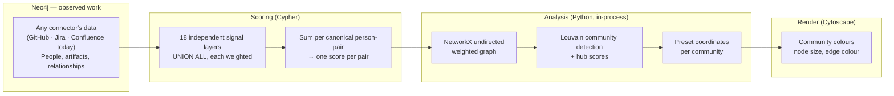
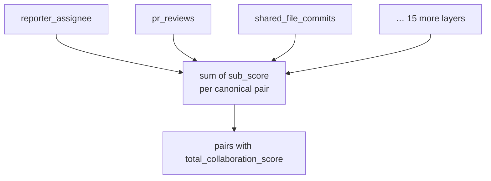
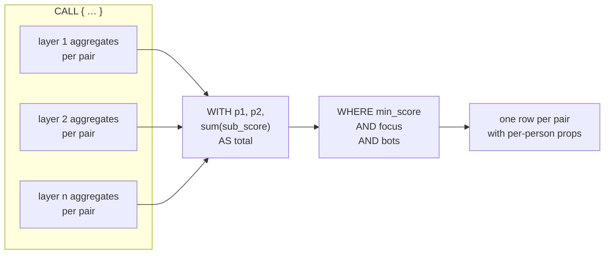
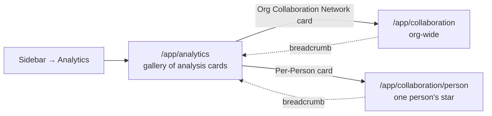
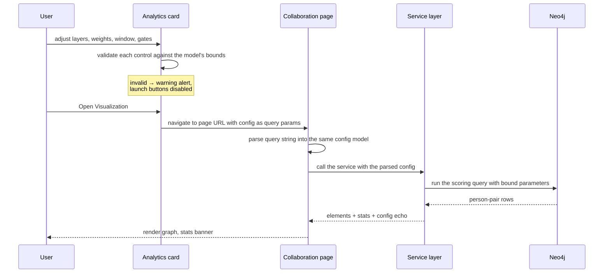

# Collaboration Network Design

**Audience:** Developers extending, debugging, or maintaining the Collaboration
Network analytics — the org-wide community detection view and the per-person
(ego) view reached from the Analytics menu.
**Status:** Implemented.
**Related docs:** [`graph-db-high-level-design.md`](graph-db-high-level-design.md)
(Neo4j schema and relationship conventions),
[`RELATIONSHIPS_DESIGN.md`](RELATIONSHIPS_DESIGN.md) (single undirected edge
rule), [`design-system.md`](design-system.md) (UI tokens),
[`runtime-settings-design.md`](runtime-settings-design.md) (the DB-backed
settings layer this feature reads timeouts and label limits from).

---

## Table of Contents

1. [Overview](#1-overview)
2. [Core concepts](#2-core-concepts)
3. [The collaboration score](#3-the-collaboration-score)
4. [DB layer](#4-db-layer)
5. [HTTP API surface](#5-http-api-surface)
6. [UI layer](#6-ui-layer)
7. [Visual encodings](#7-visual-encodings)
8. [The two views](#8-the-two-views)
9. [Extending the feature](#9-extending-the-feature)
10. [Non-goals and deliberate limits](#10-non-goals-and-deliberate-limits)
11. [Where things live](#11-where-things-live)

---

## 1. Overview

The Collaboration Network answers a question the org chart cannot: **who
actually works with whom?**

The Neo4j graph already records real interactions — who reviewed whose pull
request, who commented on whose Jira issue, who edited the same file. The
collaboration network projects those observed interactions into a single new
implicit relationship between two `Person` nodes, *collaboration*, and then
looks at the shape of that projected graph.

Two things come out of it:

- **Communities** — groups of people who collaborate densely with each other
  and sparsely with everyone else. These are the de-facto teams, which may or
  may not match the official ones.
- **Hubs** — individuals whose total collaboration volume is far above their
  peers. These are the "glue people" whose departure would fracture a
  structure they were silently holding together.

Neither answer is derived from `REPORTS_TO` / `MANAGES`. The org chart is
deliberately ignored; the point is to compare what it says against what the
data shows.

### 1.1 The network is connector-agnostic

**Nothing here is specific to GitHub, Jira or Confluence.** Collaboration is
derived from *relationships already in the graph*: any connector that writes
relationships involving a `Person` contributes to the network as soon as a
scoring layer traverses them. Today's three connectors happen to supply all 18
current layers; a fourth source — Slack, GitLab, ServiceNow, a CRM — would
supply more, with no change to the analysis, the API or the UI.

This makes **maintenance an obligation of adding a connector.** A new connector
does *not* appear in the collaboration network automatically. Its relationships
stay invisible until someone adds a layer that traverses them, and until then
the network silently **under-reports** collaboration: it looks correct, just
narrower than the data warrants.

So when a connector is added, ask whether its relationships represent people
working together. If they do, add the corresponding layer ([§9.1](#91-adding-a-collaboration-layer))
in the same change. This is the single most common way this feature drifts out
of date.

### 1.2 Pipeline at a glance



The heavy lifting is split across a language boundary on purpose: **Neo4j does
the scoring, Python does the analysis.** Cypher is very good at "count the
shared artifacts between every pair of people in a time window"; it is not the
place to run graph clustering. Python has NetworkX and `python-louvain`, and
needs no Neo4j GDS enterprise plugin.

---

## 2. Core concepts

### 2.1 Collaboration is a derived, symmetric quantity

Collaboration is not stored. It is computed from the raw work graph and thrown
away. There is no `COLLABORATES` relationship in Neo4j, no materialised edge
set, no cache.

This is a deliberate trade: the score stays correct as connectors add data, and
there is no invalidation problem, at the cost of running the scoring query
whenever a network is built. In practice that is once per page load, not once
per interaction — the page's filters operate on the elements already in the
browser (see [§6.3](#63-the-org-wide-page)).

Because "A collaborates with B" and "B collaborates with A" describe the same
fact, the pair is **canonicalised** during scoring: the two people are ordered
by element id, so `[Alice, Bob]` and `[Bob, Alice]` accumulate into one row
rather than two half-weight rows. Every signal layer applies the same
ordering rule. Downstream, the graph is undirected and edges are rendered
without arrowheads.

### 2.2 The score is an opinion, not a measurement

A collaboration score is a **weighted sum of how much evidence of working
together was observed**. The weights encode a judgement — reviewing someone's
code is a stronger signal of close collaboration than merely being assigned
tickets in the same sprint — and they are therefore configurable rather than
baked in.

The score is unitless. Its only meaningful readings are *relative*: this pair
versus that pair, this community versus that community. Nothing in the UI or
the API implies an absolute unit.

### 2.3 Signals are isolated layers

Each kind of evidence is defined as an independent **layer** — one self-
contained block in the scoring query. Layers never reference each other while
scoring; they are combined only by summing their results at the end.



This buys three things:

- **Extensibility.** A new signal — including one contributed by a new
  connector — is a new block adhering to a small contract, not a rewrite of an
  existing query or a chain of `OPTIONAL MATCH`es.
- **Switchability.** Every layer can be disabled per request, and the disabled
  blocks contribute nothing.
- **Tunability.** Every layer has an independent weight, so the relative
  importance of "reviewed a PR" versus "shares a sprint" is adjustable without
  touching code.

The layer taxonomy itself is the feature's public vocabulary: layer keys and
human labels are a single shared list, and the UI, the API parameters and the
Cypher parameters are all generated from it. A layer therefore cannot exist in
the query but be missing from the UI, or vice versa.

**The layer contract.** Each layer must do exactly three things: find the pair
of interacting people, canonicalise their order, and return a weighted
`sub_score`. Nothing else. Details of *which* Neo4j relationships each layer
traverses belong to the [DB layer](#4-db-layer).

### 2.4 Volume dampening

Naive counting breaks the analysis. Some people touch thousands of shared
artifacts — a platform engineer whose commits land in many files, a manager who
comments on many issues. Under raw counting their edges become enormous, they
connect to almost everyone, and the community structure dissolves into one
blob.

The scoring query therefore distinguishes two families of signal:

| Family | Examples | Scoring | Why |
|---|---|---|---|
| **Direct, intentional person-to-person action** | reporter↔assignee, PR reviews, explicit review requests | raw `count × weight` | The count is naturally bounded by how much one person can do *with* another. |
| **Shared-artifact co-presence** | same file, same sprint, same epic, same document, comment-on-someone's-work | `log(count + 1) × weight` | Unbounded by nature. Log compression keeps heavy sharers meaningful without letting them dominate. |

The same reasoning is applied a second time in Python: hub scores and edge
weights are both **log-normalised** before they drive node size and edge
colour, because the raw distributions are heavily skewed (a handful of very
strong ties, a long tail of weak ones). Linear normalisation would collapse
almost the entire graph into one visually indistinguishable colour.

---

## 3. The collaboration score

Putting the concepts together, the score for one pair is:

```text
score(A, B) = Σ over enabled layers L of  layer_evidence(A, B, L) × weight(L)
```

where `layer_evidence` is either a raw co-occurrence count or its log-damped
form, and the sum runs only over layers the caller enabled.

Around that sum sit four global gates, each answering a different question:

| Gate | Question it answers |
|---|---|
| **Lookback window** | How far back does "recently" reach? |
| **Minimum score** | How weak a tie is still worth drawing? |
| **Bot exclusion** | Do automated accounts pollute the network? |
| **File-suffix exclusion** | Do lockfiles, manifests and docs count as shared work? |

Bots are excluded from both endpoints of a pair, so a bot cannot enter the
network even as a hub linking two people. Suffix exclusion is narrower than the
other three: the list defaults to generated and low-signal file types
(`.json`, `.md`, `.lock`), and it exists so that coincidentally editing a
lockfile does not register as working together. It is a keyword argument of the
**shared-file layer alone** — the other layers ignore the list entirely.

All four are request-level configuration, and all four are applied **inside the
scoring query** so that uninteresting pairs never become graph nodes in the
first place.

### 3.1 The two-stage shape of the query

The scoring query has a characteristic structure worth understanding, because
it is what makes the focus filter free:



Every layer already aggregates to one row per pair *before* the union. The
outer stage only **sums** those rows. That is why filtering the output by
person (the ego view) cannot change the surviving pairs' weights — the
filtering happens after all weighting is finished. The org view and the ego
view are literally the same query; only whether the focus filter is bound to a
value differs.

Each returned pair carries both people's full property maps, so the graph
layer can attach names and any other attributes to nodes without a second
round-trip to Neo4j.

---

## 4. DB layer

### 4.1 Where the data comes from

Collaboration is computed from relationships already written by the connectors
— nothing collaboration-specific is persisted. The table below is a **snapshot
of which relationships the current layers traverse**, not a definition of what
the network is allowed to read; a new connector extends it ([§1.1](#11-the-network-is-connector-agnostic)):

| Layer family | Traverses |
|---|---|
| Jira reporting/assignment | `Person -[:REPORTED_BY]- Issue -[:ASSIGNED_TO]- Person` |
| Jira planning | `Issue -[:IN_SPRINT]-> Sprint`, `Issue -[:PART_OF]- Epic / Initiative` |
| Jira engagement | `Person -[:COMMENTED_ON]-> Issue / Epic / Initiative -[:REPORTED_BY]-> Person` |
| GitHub code | `Person -[:CREATED_BY]- Commit -[:MODIFIES]-> File`, `Person -[:REVIEWED_BY \| REQUESTED_REVIEWER]- PullRequest -[:CREATED_BY]-> Person` |
| GitHub engagement | `Person -[:COMMENTED_ON]-> PullRequest / Issue` |
| Confluence | `Person -[:CREATED \| MODIFIED]-> Page / Blogpost`, `Person -[:COMMENTED_ON]-> doc`, `doc -[:MENTIONS]-> Person` |

Two conventions from the graph design matter here:

- **Edges are undirected.** Following [`RELATIONSHIPS_DESIGN.md`](RELATIONSHIPS_DESIGN.md),
  there is one relationship per fact, so traversal patterns use undirected
  arrows (`-[:REPORTS_TO]-`) rather than picking a direction. The scoring query
  never assumes which end of a relationship a person sits on.
- **Person identity is the `wba_id`.** The graph intentionally mixes Jira and
  GitHub identities behind a canonical Person node, so a pair discovered
  through Jira and the same pair discovered through GitHub resolve to the same
  two nodes. Without this, cross-source collaboration would be invisible.

Because Jira and GitHub `Issue` nodes share a label, the GitHub-sourced and
Jira-sourced engagement layers distinguish their objects with an id-prefix
test (`issue.id STARTS WITH 'jira::Issue::'` and so on). Adding a new provider
to an existing label means adding that discriminator to the affected layers.

### 4.2 Parameterisation and safety

The scoring query is a static file —
`src/app/analytics/collaboration/queries/collaboration_score.cypher`, loaded by
`src/app/analytics/collaboration/queries_loader.py`. Everything variable — which
layers are on, their weights, the window, the gates, the optional focus person —
arrives as **bound Neo4j parameters**, never as interpolated text. The config
object owns the translation from configuration to parameter names, including
generating the per-layer `include_*` / `weight_*` pairs, so adding a layer to the
taxonomy extends the parameter set automatically and callers cannot forget one.

Because a missing parameter is a hard Neo4j error rather than a silent
default, the parameter set is all-or-nothing: every caller passes the full set
derived from the config, rather than hand-picking keys.

Query text is additionally validated as read-only before execution, using a
lexer-driven check rather than a regex over raw text — a write keyword
appearing inside a string *value* (an id, a path, a comment) must not be
mistaken for a write clause. The check fails closed.

Execution is bounded by the runtime-configurable Neo4j query timeout, so a
pathological graph cannot pin a request indefinitely.

### 4.3 Operational tooling

Two tools sit outside the request path so that tuning this feature does not
mean editing code and hoping. Neither runs in production or in CI — both are
run by hand, against a live Neo4j.

| Tool | Reach for it when |
|---|---|
| Tuning CLI | The shape of the data changed, or you want to re-check the shipped weights |
| Layer-validation suite | You suspect a layer contributes nothing, and need to know why |

**1. Tuning CLI** — `src/app/analytics/collaboration/tune.py`.

```bash
python -m app.analytics.collaboration.tune
python -m app.analytics.collaboration.tune --verbose   # list every community's members
```

Runs the scoring query with default configuration, then prints a four-part
diagnostic report: graph statistics (node/edge counts, density with a
high-density *hairball* warning), community detection (community count and
modularity, each graded against a threshold), the community size distribution,
and the top hubs. **This is how the shipped weight defaults were established**,
and it remains the tool to reach for when the data's shape changes. It exits
`2` on an empty graph and `1` on a connection or query error.

**2. Layer-validation suite** — `tests/z_collab_validation/`.

```bash
pytest tests/z_collab_validation/ -v
```

Runs each of the 18 layers **in isolation** — one layer enabled, the other 17
switched off — and records how many person-pairs each one returns on its own.
The value is that it separates two causes which look *identical* from the UI:
a layer contributing nothing because **the query is wrong**, versus contributing
nothing because **there is no activity of that kind in the window**. It writes
a timestamped HTML/JSON report per run into `tests/z_collab_validation/results/`
(gitignored), and is marked `integration` + `neo4j`, so it needs a live database
and never runs as part of the unit gate.

For a plain "what does the query return?" view, use the tuning CLI.

---

## 5. HTTP API surface

Two GET endpoints, siblings under the graph API:

| Endpoint | Returns |
|---|---|
| `GET /api/v1/graph/collaboration-network` | The org-wide community network |
| `GET /api/v1/graph/collaboration-network/ego` | One person's star of collaborators |

Both accept the same layer/weight/window/gate configuration, expressed as flat
query parameters: a comma-separated `layers` list, one `w_<layer>` per layer, and
named parameters for the window, minimum score, bot exclusion and suffix
exclusions. The org endpoint additionally accepts the topology knobs (per-node
edge cap, minimum-connection guarantee, community spacing); the ego endpoint
additionally accepts the required focus person and the collaborator cap.

The asymmetry is intentional. A star has no communities, so community spacing is
meaningless there; the ego endpoint therefore does not accept those parameters at
all, rather than accepting and ignoring them.

These endpoints are a **peer surface, not the pages' backend** — the UI calls the
service in process and never issues an HTTP request. See
[§6.7](#67-the-pages-call-the-service-not-the-api). They exist for callers outside
this application, and they are the surface the integration tests exercise.

### 5.1 Response shape

Both responses are deliberately *not* the generic graph response. Rather than raw
Neo4j nodes and relationships, they return **pre-analysed render-ready elements**
plus summary statistics:

- **`elements`** — Cytoscape element dicts: nodes carrying their community, hub
  score and pre-computed pixel size and position; edges carrying their raw weight,
  a normalised display weight and a pre-computed colour.
- **Counts and quality** — people, pairs, community count, and the Louvain
  **modularity** score for the org view; total versus shown collaborator counts
  for the ego view.
- **`config`** — the applied configuration echoed back, so a client can tell what
  it actually got rather than what it thinks it asked for. Configuration travels
  by URL and any parameter may be omitted by whoever wrote the link, so a client
  cannot assume its own reading of the URL is what the server applied.

Shipping render-ready elements rather than a generic graph is a considered
simplification: the analysis is *the product*, and re-deriving it client-side from
raw rows would mean porting Louvain into the browser.

### 5.2 Error contract

Errors are mapped to status codes by *meaning*, not by exception type:

- **400** — the caller's configuration is invalid (bad layer, bad weight, out of
  range).
- **404** — the configuration was fine but there is no data: no activity in the
  window, or no collaborations for the chosen person. This is a real and common
  outcome, so it gets its own status and an actionable hint rather than being
  lumped in with failures.
- **500** — execution failed (Neo4j unreachable) or something unexpected.

Distinguishing 404 from 500 matters operationally: "your window is too narrow"
should not page anyone, and "Neo4j is down" should.

This taxonomy is **not on the path a user's browser takes** — the pages validate
through the same configuration model and handle failures themselves. It is real,
tested and worth keeping correct; a bug in it is simply invisible in the UI.

Two exception types carry that distinction: `CollaborationDataUnavailable` for an
empty result and `ValueError` for an invalid configuration. Routes map the type
to a status and must never infer it from the message text.
`CollaborationDataUnavailable` is a `LookupError`, never a `ValueError` — the
pages treat `ValueError` as the settings case, so a subclass would be silently
misreported. The pages mirror the split, rendering an empty result as a warning
and a bad setting as an error.

---

## 6. UI layer

### 6.1 Page inventory

Neither collaboration view has a sidebar entry. Both live behind the
**Analytics** gallery, which is the single entry point for pre-built analyses:



Keeping the collaboration pages out of the sidebar is a scaling decision from
the original design: the number of pre-built analyses grows, and a sidebar of
twenty analytics entries would crowd out the navigation. The gallery absorbs
that growth, and a card is the unit of extension.

### 6.2 The URL is the configuration transport

The design keeps **one configuration UI for two consumers**: the Analytics card
and the page itself.



The consequences are worth spelling out:

- **The page is stateless with respect to configuration.** A collaboration URL
  is self-describing and shareable; pasting it reproduces the exact view.
- **There is no second configuration UI on the page.** The page's own controls
  refine the *loaded* graph; they never re-run the query (see §6.4).
- **The card is where configuration is validated.** Because the page trusts its
  URL, the card must not emit a URL it knows to be broken.
- **Both pages can also be entered directly** by deep link, so they re-parse and
  re-validate the URL themselves rather than assuming the card vetted it.

An out-of-range value is never corrected for the user. It stays exactly as
typed, the card reports it in its alert region, and the launch buttons stay
disabled until it is fixed. Quietly changing the number would tell the user
their input was accepted when it was not.

The card reads its bounds from the configuration model instead of repeating them
in the UI, so the two cannot drift.

### 6.3 The org-wide page

The page is two columns: the graph, and a details/filters panel.

- **Graph canvas** — a Cytoscape instance with a fixed `preset` layout. No
  client-side force simulation runs; positions arrive already computed. The
  initial fit is deferred until the DOM has settled and is triggered
  explicitly, because a first-paint auto-fit computes an invalid zoom while the
  container is still zero-sized.
- **Stats banner** — people, pairs, communities, modularity, window length,
  active layer count, and whether edge pruning is on. This is where the user
  reads the *quality* of the result, not just its size.
- **Filters panel** — community checklist, weight threshold, edge-count limit.
  These are **local refinements of the already-loaded graph**, not new queries.
  Dragging the weight slider re-filters elements in the browser and never
  touches the backend. That is what makes the configuration-travels-by-URL
  model workable: the expensive path runs once per navigation, and interactive
  exploration is free.
- **Details panel** — click a node or edge for its properties.
- **Spotlight** — dim everything except matches on a search term, so a person
  can be located in a large network without hunting.

Notably absent: node expansion, neighbour loading, and the context menu that
the generic graph page has. Those are exploration tools for an unknown graph;
here the graph is a computed analysis, and its meaning comes from the whole
picture rather than from drilling into one node.

### 6.4 The per-person page

Same skeleton, different question. It adds a **person picker** (the graph is
about someone, so someone must be chosen) and replaces the community and
edge-limit controls with a **collaborator cap** radio.

The picker sits in the **page header**, trailing the breadcrumb sentence, not in
the content column. It is the page's subject rather than one of its filters, and
the content column's vertical space belongs to the graph — a standalone picker
block above the canvas cost roughly 77px of it. Two consequences follow from the
move and are easy to get wrong:

- The picker is the first consumer of `create_page_header`'s `trailing` slot,
  which wraps it in a div resetting `textTransform` and `letterSpacing`. Both
  inherit from `COMPACT_PAGE_HEADER_STYLE`, so without the reset the control's
  text renders in ALL CAPS at 0.8px tracking.
- The canvas height is **not** the org page's constant. `_CANVAS_HEIGHT` in the
  ego layout is derived from the chrome this page renders above the canvas and is
  documented there; the two pages' constants were equal only while both had the
  picker in the content column.

The header supplies the picker's label, so the picker renders it visually hidden
rather than dropping it — `dbc.Input` (2.0.4) rejects `aria-label`, so a hidden
`<label>` is what keeps the input's accessible name. Because the required
asterisk lives *inside* that label, a hidden label would take the only visible
sign of requiredness with it; the picker therefore emits a separate inline `*`
after the input whenever the label is hidden **and** the picker is required.
The chip keeps the shared **stacked** form (name above, `wba_id` below) inside
the header. An inline single-line variant was tried and reverted: at the
header's width it clipped the `wba_id`, and the id is the reason the chip shows
it at all — it is what disambiguates two people sharing a display name. The
header host restyles only the chip's padding and type size; the stacking,
ellipsis and clear button come from the shared `.catalog-person-chip-*` rules
unchanged. The cost is that the header row grows to the chip's height (~46px
against ~24px inline) once a person is selected, which the canvas height budget
absorbs.

Both of the page's search affordances are sized up to suit a header control —
the picker to 14px, the node spotlight to 13px and a wider box — since at the
shared 12px the picker was the smallest text in the header. Three constraints
govern those overrides, all of them easy to miss:

- The picker's size **must** be `!important`. `build_person_picker` sets
  `fontSize` inline, and an inline style outranks any selector, so a rule
  without it silently does nothing. The repo already relies on this behaviour
  for the form-control radius (see the note on `.form-control` in the stylesheet).
- The overrides are **scoped**, to the picker's host class and to `#ego-page`
  respectively. Both controls are shared — the picker with the Graph page's
  catalog, the spotlight with the Graph and org pages — so an unscoped change
  would resize every other page's controls too.
- The spotlight's **height is deliberately not changed**. It is not the tallest
  item in the controls bar, so growing it would push the canvas down and
  invalidate `_CANVAS_HEIGHT`.

The cap is the one control that interacts with the fetch. It keeps the **N
strongest** collaborators by raw weight, and the fetch happens once at the value
the page was launched with. The in-page radio therefore only ever *narrows* the
loaded set, without re-fetching — a cap the page never fetched could not take
effect, so offering it would be a dead control.

### 6.5 Deep-linking the per-person network

Any component that knows a Person's `wba_id` — a person list, a node in the
graph, a search result, an external tool — can link straight to that person's
network. The URL is:

```text
/app/collaboration/person?person=<encoded-wba-id>[&max_collaborators=<n>][&<settings…>]
```

| Parameter | Required | Meaning |
|---|---|---|
| `person` | No\* | Focus Person's canonical `wba_id`, e.g. `github::Person::alice`. Percent-encoded. |
| `max_collaborators` | No | Collaborator cap to fetch with. Defaults to 25; clamped to 1–500. |
| *collaboration settings* | No | `layers`, `lookback_days`, `min_pair_score`, `exclude_bots`, `exclude_suffixes`, `w<sub>_layer</sub>` — the same settings [§6.2](#62-the-url-is-the-configuration-transport) describes. |

\* Omitting `person` is valid: the page opens on its "pick a person" prompt.
That is what the Analytics card itself does, since the card configures
*settings* and leaves the person to the user.

**Percent-encode the id.** A `wba_id`'s id segment can contain characters that
are reserved in a URL — a `#` truncates the value at the fragment
(`github::PullRequest::org/repo#1` loses everything after the `#`), a `+`
becomes a space, and an `&` splits off a new parameter. A malformed `person`
degrades to the picker prompt rather than an error, and an out-of-range
`max_collaborators` is clamped, so a bad link fails quietly rather than loudly.

Rather than assembling the string by hand, use the builder, which encodes
correctly for every id:

```python
from app.common.person_network_url import build_person_network_url

build_person_network_url("github::Person::alice", max_collaborators=50,
                         extra_params={"lookback_days": 30})
```

`src/app/common/person_network_url.py` is the **single source of truth** for the
contract, holding both `build_person_network_url` for producers and
`parse_person_network_url` for the page, so the two cannot drift. A producer that
must reject a bad id rather than link to nobody can call `is_valid_wba_id`
first; the builder encodes whatever it is given, so an invalid id produces a link
the page treats as "no person".

### 6.6 Error and empty states

Both pages report configuration and execution problems as a danger alert in the
stats banner region, in plain sentences rather than a raw validation dump.
Unexpected exceptions are logged server-side and surfaced generically, never as
a traceback.

The two views differ in what "nothing to show" means:

- **The org view** is always configured, so an empty result is a statement about
  the data: no collaboration matched these parameters.
- **The per-person view** has a genuine pre-input state. "Pick a person" must
  stay distinct from "this person has no collaborators," so the page validates
  the URL's settings before a person is chosen and can report a malformed deep
  link while still showing the picker prompt.

### 6.7 The pages call the service, not the API

Dashboard and API run in the **same Python process** — the Dash app is mounted
onto the FastAPI application rather than deployed beside it. The collaboration
pages therefore import the service functions and call them directly, in process,
with no HTTP request. The repo contains several ways of reaching the backend, so
the choice is worth reading off the code rather than assuming:

| Consumer | How it reaches the backend |
|---|---|
| Collaboration pages (org + ego) | Direct in-process call to the service function |
| Search page | `requests` over HTTP to `API_BASE_URL` |
| Analytics gallery | Neither — it builds a URL for the browser and makes no backend call |
| External clients, scripts, `curl` | The `/api/v1/graph/collaboration-network*` endpoints |

The endpoints' URL-shaped parameter passing is a consequence of being a REST
resource, not the mechanism behind the UI's configuration-by-URL model — that
rests on the Dash *page* routes being deep-linkable, as [§6.2](#62-the-url-is-the-configuration-transport)
describes. In-process callers also get the applied configuration object back
directly, so neither surface depends on the other for it.

### 6.8 The service behind both surfaces

`CollaborationNetworkConfig` (`src/app/analytics/collaboration/config.py`) is the
one validation model all collaboration configuration flows through, and the
module holds the tables it is defined against — so the Cypher, the API parameters
and the UI are generated from one file rather than kept in sync by hand
([§9.2](#92-changing-a-default-or-a-bound)).

One subtlety in its contract: an **empty** layer list is valid and means "no
layers", yielding an empty network rather than an error. Parsing preserves the
difference between that and an unspecified list, which means "all layers" —
exactly the case a user hits when they switch every layer off.

The service functions are **synchronous**, because the work is blocking: a
synchronous Neo4j call, then CPU-bound NetworkX and Louvain. The thread offload
is therefore a property of the HTTP layer only — `async` route handlers dispatch
to a worker thread with `asyncio.to_thread`. The in-process path of
[§6.7](#67-the-pages-call-the-service-not-the-api) has no such protection and
blocks the Dash thread for the duration, which is acceptable because the callback
*is* the user's request and its loading overlay is the feedback.

There is **no caching**: every build re-runs the query and re-partitions the
graph. Caching is the obvious next optimisation if this becomes a bottleneck, but
it would introduce an invalidation problem the design currently avoids.

---

## 7. Visual encodings

A force-directed hairball is unreadable at org scale. Every visual channel
therefore carries a specific, deliberate meaning:

| Channel | Encodes | Reading |
|---|---|---|
| **Node colour** | Detected community | Which de-facto team this person belongs to. Compare against the org chart. |
| **Node size** | Log-normalised hub score (weighted degree) | The glue people. A large node leaving would fracture the structure around it. |
| **Node position** | Community + hub rank, computed server-side | Communities are spatially separated clusters; within a cluster the highest-hub person sits at the centre with others radiating outward. |
| **Edge colour** | Log-normalised weight, on a multi-hue ramp | How strong this pairing is. |
| **Edge opacity** | Log-normalised weight | Weak edges are semi-transparent (0.5), strong ones nearly opaque (0.9). A gentle de-cluttering effect — the graph gets quieter without hiding data. |
| **Edge stacking** | Log-normalised weight | Strong edges are drawn on top, so a strong tie is never buried under weak ones crossing it. |
| **Edge thickness** | — | **Not** weight-driven. Edges are 2px, and 2px is the base `edge` rule's `width`. See below. |
| **Edge direction** | — | Collaboration is symmetric, so arrowheads are suppressed. |

**Edge thickness is constant, so hue carries the strength signal.** Every edge
gets a 2px width from the base `edge` rule; nothing maps width to weight. Of the
two client-side `mapData(normalized_weight, …)` mappings, opacity spans only
0.5–0.9 and z-index is a stacking tiebreak rather than a visual channel. The
strength signal therefore rests on **line colour**, a pre-computed hex string
supplied per edge by the backend (`_edge_line_color`) and read via
`data(_edge_line_color)`. That bypasses `mapData()`, which can only interpolate
between two colours — the seven-stop ramp is computed in Python instead, where a
full-spectrum colour map is available.

The raw `weight` field remains the input to the client-side filters (weight
threshold, edge-count limit) and to sorting; the normalisation is purely a
display concern.

Two further encoding decisions are load-bearing:

1. **Communities get their own spatial regions, not just colours.** Colour alone
   fails for colour-blind users and for large community counts; spatial
   separation makes the structure legible from the layout itself. The spacing
   between community centroids is configurable, because the right amount depends
   on how many communities there are and how large they are.
2. **Community count is unbounded in the data but bounded in the palette.**
   There are 20 community colour classes, applied only where a CSS class name is
   needed — the count in the banner, the modularity calculation and the
   community filter all use the true partition. The mapping is **modular, not
   clamped** (`id % 20`), so past 20 communities colours are *reused* across the
   spectrum rather than collapsing into one, and the tuning CLI warns when this
   happens. The residual limitation is inherent: node colour alone can no longer
   distinguish every community, which is why position is the primary channel and
   colour the secondary one.

**Determinism keeps the encodings readable.** Louvain is randomised but seeded
with a fixed random state, so the same graph always produces the same partition;
without it, community colours would visibly jitter between reloads of unchanged
data and the view would be useless for comparison. Server-side preset
coordinates follow the same reasoning — a reload does not reshuffle the layout.

---

## 8. The two views

The org view and the ego view are not two features; they are **one scoring
engine with two framings**, and they share the query file so they can never
disagree about what a collaboration is worth.

| | Org-wide | Per-person (ego) |
|---|---|---|
| Question | What are the organic teams? | Who does this person work with, and how closely? |
| Topology | Full graph, everyone and every pair | A pure star: one focus, one spoke per collaborator, no collaborator-to-collaborator edges |
| Analysis | Louvain + hub scores + modularity | None — a star has no communities |
| Layout | Communities on a grid, members in rings | Concentric rings by relationship strength |
| Size facet | Community | Individual collaborator |
| Main risk | Hairball | Missing the strongest relationship in the noise |

The divergences are not shortcuts; each follows from the topology:

- **No Louvain.** Partitioning a star returns either one community or many
  singleton ones. Neither is an insight.
- **No hub score.** Hub score is weighted degree over the whole graph. In a
  star every spoke has exactly one edge, so the number is meaningless.
- **No node sizing.** With no meaningful hub score there is nothing to encode,
  so nodes stay uniform and the *position* channel carries the strength
  instead.
- **Re-normalised edge strength.** Weights are normalised over the focus
  person's **full** collaborator set *before* any cap or threshold is applied.
  The closest collaborator is therefore always the strongest colour, and
  changing the cap never recolours the graph. Normalising after filtering would
  make the same relationship look strong or weak depending on an unrelated UI
  setting.
- **Narrow the star, never widen it.** The collaborator cap keeps the view
  readable and keeps the strongest relationships visible. Since the natural
  failure of a star is too many spokes, the cap defaults to a value that is
  legible rather than to "all".

The radial layout itself has one non-obvious requirement: spokes must not
overlap. A fixed innermost radius fails as spokes are added, because the arc
between adjacent spokes shrinks with their count while the person node's width
does not. The innermost radius is therefore *scaled* with the collaborator
count to hold the angular separation above a floor. This cannot be fixed at
render time — zoom is uniform, so overlap is scale-invariant.

---

## 9. Extending the feature

### 9.1 Adding a collaboration layer

**A new connector is not finished until this section is considered.** Adding a
connector that writes `Person` relationships without adding a layer leaves its
collaboration invisible, and the network will under-report without looking
wrong ([§1.1](#11-the-network-is-connector-agnostic)). The layer taxonomy is the
contract, and it drives the query, the API parameters and the UI. Adding a layer
means touching, in order:

1. The **taxonomy** — layer key, human label, default weight.
2. The **scoring query** — one new block following the three-rule contract
   (find the pair, canonicalise the order, return a weighted `sub_score`).
   Choose raw counting for direct person-to-person actions and log dampening
   for shared-artifact co-presence.
3. The **API parameter surface** — a new weight parameter, so the layer is
   configurable per request.
4. The **UI** — the layer appears in the card's layer/weight table
   automatically, since the table is generated from the taxonomy.

If the connector reuses an existing node label that another provider already
writes — as Jira and GitHub both do for `Issue` — the new layer also needs the
id-prefix discriminator described in [§4.1](#41-where-the-data-comes-from), or
it will read the other provider's nodes.

Per-layer validation exists precisely to make step 2 verifiable: run the new
layer in isolation and confirm it returns rows before trusting it in
combination.

### 9.2 Changing a default or a bound

Both live in `src/app/analytics/collaboration/config.py`, and the UI reads them
from there rather than restating them:

- **Bounds** are the `ge` / `le` constraints on `CollaborationNetworkConfig`'s
  `Field` declarations. The card extracts them from
  `CollaborationNetworkConfig.model_json_schema()`, so changing a constraint
  updates the card's validation and its user-facing message together.
- **Defaults** are the module-level `DEFAULT_*` constants, plus
  `DEFAULT_LAYER_WEIGHTS` for per-layer weights. The card imports these directly
  for its initial control values, so a changed constant is picked up on the next
  page render.

The rule either way: never restate a bound or a default in the UI. Note one
place where a default *is* restated: the `w_<layer>` parameters on the API router
(`src/app/api/graph/v1/router.py`) carry literal defaults rather than reading
`DEFAULT_LAYER_WEIGHTS`, so changing a weight means editing both.
`test_route_declares_every_setting_with_the_expected_default` asserts the two
agree and fails on drift, so the duplication is checked rather than trusted.

### 9.3 Adding a third view

A new framing of the same score should reuse the scoring query and the shared
configuration model, and add only: a service function, an endpoint, a registry
entry, and a page. If it needs a new kind of analysis (not just a new
projection), that analysis belongs in the analytics package beside the existing
pipeline, not in the service or the page.

---

## 10. Non-goals and deliberate limits

Worth knowing before proposing changes, because each was a considered choice:

- **Coverage is only as wide as the layers** ([§1.1](#11-the-network-is-connector-agnostic)).
  A connector whose relationships no layer traverses contributes nothing, and
  the result looks plausible while under-reporting. This is a standing
  maintenance obligation, not a one-time gap.
- **Collaboration is not persisted** ([§2.1](#21-collaboration-is-a-derived-symmetric-quantity)).
  A stored edge would be a second definition of the score, and would need
  invalidation as connectors add data.
- **The org chart is not an input.** `REPORTS_TO` / `MANAGES` are deliberately
  excluded from every layer, because the value of the view is the comparison
  between detected and official structure ([§1](#1-overview)).
- **No GDS dependency.** Analysis runs in Python, which keeps deployment free
  of the Neo4j GDS plugin. The documented escape hatch, if the graph ever
  outgrows in-memory NetworkX, is to move Louvain into GDS.
- **No caching.** Every request recomputes ([§6.8](#68-the-service-behind-both-surfaces)).
- **Community identity is not stable across parameter changes.** Communities
  are numbered per run. Reloading the same URL on unchanged data gives the same
  partition, but changing the window or weights can legitimately renumber — and
  re-shape — communities. Community ids are a property of a computation, not a
  durable label for a team.
- **Layer isolation is about correctness, not speed** ([§2.3](#23-signals-are-isolated-layers)).
  Running all layers is a single query; disabling layers does not make it
  cheaper in any way the design relies on.
- **The page's filters are local.** Community, threshold and edge-limit
  filtering happen in the browser over the loaded elements. Changing them does
  not recompute the graph, so a filtered view's community structure still
  reflects the *unfiltered* graph ([§6.3](#63-the-org-wide-page)).

---

## 11. Where things live

| Concern | Location |
|---|---|
| Configuration model, layer taxonomy, defaults, bounds | `src/app/analytics/collaboration/config.py` |
| Scoring query (the 18 layers) and its loader | `src/app/analytics/collaboration/queries/` |
| Org pipeline: graph, Louvain, hubs, positions, elements | `src/app/analytics/collaboration/algorithm.py` |
| Ego pipeline: star, radial layout, elements | `src/app/analytics/collaboration/ego.py` |
| Per-person deep-link URL contract (build + parse) | `src/app/common/person_network_url.py` |
| Tuning CLI, validation suite | `src/app/analytics/collaboration/tune.py`, `tests/z_collab_validation/` |
| Analytics registry (gallery metadata) | `src/app/analytics/registry.py` |
| Endpoints, service functions, response models | `src/app/api/graph/v1/{router,service,model}.py` |
| Analytics gallery and its cards | `src/app/dash_app/pages/analytics.py` |
| Org page package | `src/app/dash_app/pages/collaboration_network/` |
| Ego page package | `src/app/dash_app/pages/collaboration_network_ego/` |
| Community palette and Cytoscape selectors | `src/app/dash_app/graph_styles.py` |
| Node base dimensions and dynamic sizing | `src/app/common/node_size.py` |

One convention specific to these pages: the two page packages are
**self-contained by design**. Anything shared between them lives outside
`pages/` — in `dash_app/components/` or `dash_app/graph_styles.py` — for the
circular-import reason in CLAUDE.md's Dash UI rules. When the ego view needed the
org view's trait helpers, those helpers were moved to the analytics package
rather than imported across pages.
