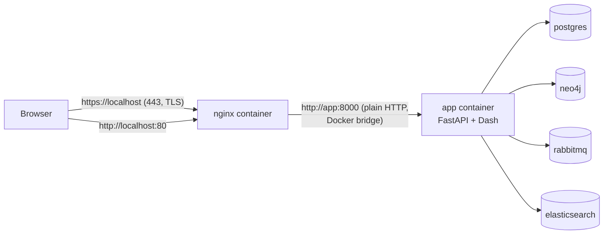

# nginx TLS Termination and Proxy Design

## Overview

Browsers reach the application over HTTPS served by an nginx reverse proxy running as its
own Compose service. nginx terminates TLS on port 443 with a certificate mounted read-only
from `deploy/certs/`, and forwards every request to the `app` container as plain HTTP on
port 8000 over the Docker network. The application has no TLS configuration, no
certificate, and no knowledge of the port the browser connected to.

TLS terminates at the edge rather than in the application because certificate management
stays out of the application image, and because it matches the AWS target topology, where
API Gateway terminates TLS and forwards plain HTTP. To support either ingress the
application is *proxy-aware* — it never derives its external scheme or host from its own
listener.

The authoritative configuration is `deploy/nginx/nginx.conf`, mounted into the `nginx`
container at `/etc/nginx/nginx.conf`; the Compose service definition is in
`docker-compose.yml`.

## Design Decisions

| # | Decision | Choice | Rationale |
|---|---|---|---|
| 1 | Where TLS terminates | nginx, in a separate container | Keeps certificate management out of the application image; matches the AWS target where TLS terminates at API Gateway |
| 2 | URL topology | Single host, path-based: `/app` → Dash UI, `/api` → API, `/` → 302 to `/app` | UI and API share one origin, so no CORS configuration is required and there is a single external origin |
| 3 | External vs internal URL | Two distinct settings: `EXTERNAL_BASE_URL` (`https://localhost`) and `API_BASE_URL` (`http://localhost:8000`) | The browser-facing and container-internal URLs are different by design; conflating them sends every Dash callback through TLS to the public host and breaks the UI |
| 4 | Trusting forwarded headers | uvicorn `--forwarded-allow-ips="*"`, with uvicorn's default `--proxy-headers` left alone | `ProxyHeadersMiddleware` is already on by default; only the trusted-peer set changes. `*` is safe solely because the app publishes no host port |
| 5 | SSE stream handling | `proxy_buffering off;` + `proxy_cache off;` on `location /api/v1/chats/` | The chat endpoint is a POST SSE stream called directly by the browser; with buffering on nginx holds the whole response and the user sees nothing until it completes |
| 6 | Request body size | `client_max_body_size 50m;` in the `http` block | nginx defaults this to `1m`, below the size of Dash callback payloads — the Collaboration Network serialises rendered component trees that exceed 1 MiB |
| 7 | `/auth` path | Reserved and commented out | Reserving the path prevents an application route from being served there, and documents the forwarding directives an identity provider needs |
| 8 | Port exposure | Only nginx publishes ports 443 and 80; the app publishes nothing | Makes TLS *enforced* rather than advisory — with no published app port there is no plaintext path to the application |
| 9 | Certificates | mkcert for local development; certs in `deploy/certs/`, gitignored, never committed | A development-only trust story. A real deployment uses a certificate from a real CA; mkcert is not production-appropriate |
| 10 | Container-to-container traffic | Plain HTTP on the Docker bridge | TLS terminates once, at the edge; encrypting internal traffic would require a CA bundle in every image for no threat improvement |
| 11 | AWS API Gateway | Same code, TLS at the gateway, nginx removed | Works without code changes because the app derives nothing from its listener. The topology and its streaming constraint are designed in `docs/design/authn-authz-design.md` ("Deployment Topologies") |

## Topology



Two listeners exist. The `:443` server block carries the certificate and routes every real
path. The `:80` server block does nothing but `return 301 https://$host$request_uri;` — it
has no `proxy_pass` and no upstream, so it can never serve application content, only
redirect to the encrypted listener. That is why publishing port 80 is safe.

The upstream is declared once, in the `http` block:

```nginx
upstream wba_app {
    server app:8000;
}
```

`app` is the Compose service name, resolvable on the `wba-ai-network` Docker network. No
DNS name outside the Compose network is involved, and nginx cannot be started independently
of the application stack.

## Request Routing

Routing is by longest-prefix match on the request path. Four locations exist, plus one
reserved.

| Path | Handler | Notes |
|---|---|---|
| `/api/v1/chats/` | `proxy_pass http://wba_app` (unbuffered) | The SSE stream. Longest-prefix match means it wins over `/api` regardless of order in the file |
| `/api` | `proxy_pass http://wba_app` | Covers `/api/health` and `/api/v1/*` |
| `/app` | `proxy_pass http://wba_app` | The Dash UI and its assets (`/app/assets/*`, `/app/_dash-*`) |
| `/` (exact) | `return 302 /app` | So the root is useful rather than a 404 |
| `/auth` | *reserved* | Commented out; see "Reserved `/auth` Path" |

Two properties of these blocks are load-bearing:

- **`proxy_pass` has no trailing slash or path component.** `proxy_pass http://wba_app;`
  forwards the request URI unchanged, so `/app/_dash-update-component` arrives at the
  application still prefixed with `/app`. This matches `requests_pathname_prefix="/app/"`
  set in `src/app/dash_app/layout.py`, and it is why no `X-Forwarded-Prefix` handling is
  needed and Dash's generated URLs stay valid.
- **Every proxied location forwards the same header set**: `Host`, `X-Real-IP`,
  `X-Forwarded-For`, `X-Forwarded-Proto`, and `X-Forwarded-Host`.

FastAPI's default `/docs`, `/redoc`, and `/openapi.json` endpoints are not routed by any
location block, so they are unreachable from outside the Docker network. That is a
consequence of the routing rather than an explicit denial.

## Request Body and Buffering Limits

Two nginx defaults are incompatible with this application, and both fail silently. Any new
route added to the proxy must be considered against both.

**Request body size.** nginx defaults `client_max_body_size` to `1m`. Dash serialises the
rendered component tree into its `_dash-update-component` payloads, and the Collaboration
Network's callbacks — the community filter, the `collab-cytoscape.elements` payload, and
the filter results — exceed 1 MiB. Exceeding the limit produces `413 Content Too Large` in
the browser's network panel and the page renders nothing.

The directive is set in the `http` block, so it applies to every server and location:

```nginx
# Dash callback payloads (collaboration network) exceed nginx's 1m default.
client_max_body_size 50m;
```

`50m` is a judgement bound, not a derived one: comfortably above any plausible Dash payload
while still bounding abuse.

**Response buffering.** nginx defaults `proxy_buffering` to `on`, which holds the upstream
response and sends it on completion. That is an optimisation for an ordinary request; for a
stream it means the client receives nothing until the stream ends. The chat endpoint at
`POST /api/v1/chats/{session_id}/stream` returns a `StreamingResponse` with
`media_type="text/event-stream"`, called directly by the browser via `fetch` in
`src/app/dash_app/assets/stream-bridge.js` — not through Dash's callback machinery. Its
location therefore disables buffering and caching explicitly and extends the read timeout:

```nginx
location /api/v1/chats/ {
    proxy_pass http://wba_app;
    proxy_buffering off;
    proxy_cache off;
    proxy_read_timeout 3600s;
    # ... forwarded headers
}
```

`proxy_read_timeout` is deliberately long because an LLM response can pause between tokens
for an unbounded interval; the default 60s would cut a slow stream. **Any streaming
endpoint must be routed to this location**, or it will buffer silently: the request
succeeds, the response is complete, and no incremental output is ever seen.

## Proxy Awareness and the External URL Contract

The application never constructs an absolute URL from the connection it is serving. Two
settings in `src/app/settings.py` separate the two identities it needs:

```python
EXTERNAL_BASE_URL: str = "https://localhost"
API_BASE_URL: str = "http://localhost:8000"
```

These are **deliberately different values**, and they must stay that way.

`EXTERNAL_BASE_URL` is the URL the *browser* uses. It is the single source of truth for
anything that has to be reachable from outside. It must never be derived from the request,
because behind the proxy the request arrives on port 8000 over plain HTTP and its own
scheme would be `http`.

`API_BASE_URL` is the URL the *Dash code* uses to call the API. The Dash callbacks run
inside the same container as the API, so they call it over the container's own loopback at
`http://localhost:8000`, in plain HTTP, without traversing nginx at all. Nine Dash call
sites read this value from the settings singleton.

Conflating the two breaks the entire UI: pointing `API_BASE_URL` at `EXTERNAL_BASE_URL`
sends every Dash callback through TLS to the public hostname, from inside the container,
where that name does not resolve the way the browser resolves it. A unit test asserts the
two settings are independent.

nginx supplies the external identity through headers on every proxied location:

| Header | Value | Purpose |
|---|---|---|
| `Host` | `$host` | The browser's hostname, not the upstream address |
| `X-Real-IP` | `$remote_addr` | The immediate client address |
| `X-Forwarded-For` | `$proxy_add_x_forwarded_for` | The client chain |
| `X-Forwarded-Proto` | `$scheme` | `https` — the scheme the browser used |
| `X-Forwarded-Host` | `$host` | The browser-facing host |

On the application side, uvicorn consumes these through its `ProxyHeadersMiddleware`, which
rewrites `scope["scheme"]` and the client address when the peer is trusted. Two facts about
that mechanism matter here:

- **`--proxy-headers` is already enabled by default** in the installed uvicorn, and uvicorn
  wraps the application with the middleware at server startup. There is therefore no reason
  to pass the flag, and passing it implies it is doing work it is not.
- **The flag that changes behaviour is `--forwarded-allow-ips`**, which sets the trusted
  peer set. Its default is `127.0.0.1,::1`, which does *not* include nginx's container
  address, so without it the forwarded scheme would be discarded and the application would
  believe every request arrived over plain HTTP.

`src/app/entrypoint.sh` therefore launches uvicorn as:

```bash
cd /app && uvicorn app.main:app --host 0.0.0.0 --port 8000 \
    --forwarded-allow-ips="*"
```

The value `*` means "trust any peer" and is safe **only** because the application container
publishes no host port. With no published port, the only peers that can reach port 8000 are
nginx and the other containers on the Compose network, all of which are under this
repository's control. Re-publishing a host port would make `*` a header-spoofing hole: any
host-level client could then reach the app directly and assert an arbitrary
`X-Forwarded-Proto` or `X-Forwarded-For`. The comment in `entrypoint.sh` states this
coupling so the two are kept in sync.

Note that a hardcoded subnet (e.g. `172.16.0.0/12`) is not a better answer: Docker assigns
bridge subnets from a pool, and if the assigned subnet falls outside whatever is hardcoded,
nginx's headers are silently ignored.

## Reserved `/auth` Path

The path `/auth` is reserved and no application route may be served there. The location
block exists in `deploy/nginx/nginx.conf` but is commented out, so nothing is currently
served at that path and an accidentally-added application route there would not shadow the
reserved namespace. The block documents the forwarding directives an identity provider
needs:

```nginx
# location /auth {
#     proxy_pass http://keycloak:8080;
#     proxy_set_header Host              $host;
#     proxy_set_header X-Forwarded-For   $proxy_add_x_forwarded_for;
#     proxy_set_header X-Forwarded-Proto $scheme;
#     proxy_set_header X-Forwarded-Host  $host;
# }
```

When enabled, the provider must itself be configured to match this path layout:
`KC_HTTP_RELATIVE_PATH=/auth` so it emits URLs under `/auth`, and `KC_PROXY_HEADERS=xforwarded`
so it honours the forwarded headers exactly as the application does. Without both, the
provider generates URLs based on its own listener and they will not match what the browser
reaches.

Authentication, sessions, cookies, and the provider's realm are out of scope for this
document; `docs/design/authn-authz-design.md` owns them. This document owns only the
transport: the reserved path and the header contract the provider must participate in.

## Port Exposure

| Service | Published ports | Notes |
|---|---|---|
| `nginx` | `443:443`, `80:80` | 443 terminates TLS; 80 is a 301 redirect only, with no upstream |
| `app` | *none* | Reachable only on the Docker network, as `app:8000` |

The application service has no `ports:` key at all. This is the decision that makes TLS
enforced rather than advisory: with no published app port, there is no plaintext route to
the application from the host, so a client cannot bypass the proxy by using a different
port.

The application's container healthcheck runs entirely inside the container against
`http://localhost:8000/api/health`, where the application continues to listen on port 8000.
It is deliberately not repointed at nginx — the healthcheck should report on the
application, not on the proxy in front of it. The `nginx` service waits for the application
to report healthy before starting.

## Certificate Policy

Certificates are issued locally with [mkcert](https://github.com/FiloSottile/mkcert), which
creates a local certificate authority and issues server certificates signed by it. The
generated files live at:

| File | Content |
|---|---|
| `deploy/certs/wba.pem` | Server certificate and its chain |
| `deploy/certs/wba-key.pem` | The matching private key |
| `deploy/certs/.gitkeep` | Placeholder so the directory exists in a fresh checkout |

The directory is mounted read-only into the nginx container at `/etc/nginx/certs`, and the
certificate subject must cover `localhost` to match `server_name localhost;` in the nginx
configuration.

**No key material or certificate contents belong in this repository.** `.gitignore`
contains:

```
deploy/certs/*
!deploy/certs/.gitkeep
```

so the certificate and key are excluded while the directory placeholder is tracked.

**Trust stores.** `mkcert -install` adds the local CA to the trust store of the machine it
runs on. On WSL2 the browser usually runs on Windows, which reads a different trust store,
so the Linux-side install does not silence the browser warning. The CA must be imported
once into the Windows certificate store (Administrator PowerShell,
`Import-Certificate ... -CertStoreLocation Cert:\LocalMachine\Root`) — a one-time manual
step per developer machine that cannot be automated from the repository. Firefox does not
read the Windows root store at all; it needs its own trust configuration.

**This is a local-development mechanism, not a deployment one.** mkcert certificates are
signed by a private CA that exists only on developer machines, so they are trusted only
there and only by software configured to trust that CA. A real deployment needs a
certificate from a real certificate authority.

mkcert certificates default to roughly a two-year lifetime. On expiry the browser shows a
warning and any client without an insecure-skip flag fails outright; re-issue the
certificate to recover.

Moving to a real hostname means changing `server_name` in the nginx configuration, adding
the name to the `mkcert` invocation, reissuing the certificate, and updating
`EXTERNAL_BASE_URL`. The old certificate must be regenerated rather than reused — a
certificate issued for `localhost` is rejected for any other hostname.

## Internal Plain-HTTP Traffic

**Decision: container-to-container traffic is plain HTTP on the Docker bridge, and TLS is
terminated only at the edge.** The application calls its own API, the producers and the
consumer call the API, and nothing between containers is encrypted.

This is deliberate, not an oversight. The threat model the TLS arrangement addresses is the
browser-to-server hop, which traverses a host network. The container network is a private
Docker bridge, reachable only from within the Compose stack. Encrypting it would require a
CA bundle mounted into every service image, certificate rotation across all of them, and
changes at every internal call site.

Reversing this decision would put all of the following in scope:

- every `API_BASE_URL` call site in the Dash code,
- the producers' and consumer's `API_SERVER` (currently `http://app:8000/`),
- a CA trust bundle mounted into every service image,
- a certificate-issuing process for the internal hostnames.
